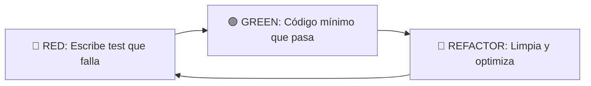

# Capítulo 05: Testing with Pytest

El código sin pruebas (tests) es código legacy desde el momento en que se escribe. Pytest es el framework estándar de la industria en Python para asegurar que tu código hace exactamente lo que promete.

## 1. La Anatomía Universal de un Test

No importa el lenguaje, un buen test sigue el patrón de las tres Aes: **Arrange, Act, Assert** (o Given, When, Then).

### Analogía: Control de Calidad en una Fábrica
Imagina una fábrica de automóviles. Para probar que los frenos funcionan:
1. **Arrange (Preparar):** Traes el auto a la pista de pruebas y le pones gasolina.
2. **Act (Actuar):** Aceleras a 100km/h y pisas el freno a fondo.
3. **Assert (Afirmar):** Mides si el auto se detuvo en menos de 40 metros. Si es así, el test pasa. Si no, falla.

### Ejemplo de Código
```python
# class ShoppingCart a testear
class ShoppingCart:
    def __init__(self):
        self.items = []
    def add(self, item):
        self.items.append(item)

# El Test
def test_cart_adds_items_correctly():
    # 1. ARRANGE (GIVEN): Preparar el auto
    cart = ShoppingCart()
    
    # 2. ACT (WHEN): Pisar el freno (ejecutar la acción)
    cart.add("Manzana")
    
    # 3. ASSERT (THEN): Medir si se detuvo (afirmar estado final)
    assert len(cart.items) == 1
    assert cart.items[0] == "Manzana"
```

## 2. Fixtures: Evitando Código Repetitivo

Si tienes 5 tests que necesitan un `ShoppingCart` vacío, no instancies el carrito manualmente en cada test. Usa `@pytest.fixture`. Un Fixture es una función que provee "datos/objetos prefabricados" a tus tests.

### Analogía: El Programa de Cocina
En los programas de cocina en TV, el chef nunca pela las zanahorias en vivo. Alguien en la "cocina de preparación" ya dejó todos los ingredientes picados en platitos (los fixtures). Así, el chef (el test) se enfoca solo en cocinar (testear la lógica de negocio) sin perder tiempo preparando.

### Ejemplo de Código
```python
import pytest

@pytest.fixture
def empty_cart():
    # El asistente de cocina prepara el platito
    return ShoppingCart()

# En lugar de hacer el ARRANGE adentro, pedimos el platito en los parámetros
def test_cart_is_empty_initially(empty_cart):
    # ACT / ASSERT directos
    assert len(empty_cart.items) == 0

def test_cart_adds_items_correctly(empty_cart):
    # Ya tenemos el objeto listo gracias a empty_cart
    empty_cart.add("Pera")
    assert "Pera" in empty_cart.items
```

## 3. Mocks: Aislando Componentes

A veces tu clase depende de otra clase externa (ej. una conexión a Base de Datos). **Los Unit Tests no deben depender de sistemas externos.** Si tienes que testear tu lógica, debes "fingir" (mockear) la respuesta del sistema externo.

### Analogía: Los Crash Test Dummies
Cuando las automotrices prueban la seguridad de un auto en un choque, no suben a humanos reales. Sería peligroso, caro y no repetible de forma controlada. Suben muñecos plásticos (Crash Test Dummies) que *fingen* ser humanos.
Un **Mock** es un muñeco plástico. En lugar de pegarle a una Base de Datos real (que es lenta y se puede caer), le pegas a un Mock que finge responder "Guardado Exitosamente".

### Ejemplo de Código
```python
from unittest.mock import Mock

def test_database_call_without_database():
    # GIVEN: Un muñeco plástico que finge ser la base de datos
    mock_db = Mock()
    mock_db.save.return_value = True # Fingimos que guarda exitosamente
    
    # Supongamos que esta clase guarda en DB
    manager = ProductManager(database=mock_db)
    
    # WHEN
    result = manager.save_product("Laptop")
    
    # THEN
    assert result is True
    # Verificamos que el manager realmente intentó guardar en la BD falsa
    mock_db.save.assert_called_once_with("Laptop")
```

## 4. Testing de Entrada/Salida (I/O) con el Fixture Nativo `tmp_path`

En Data Engineering y pipelines, con frecuencia probamos clases que leen o escriben archivos en disco (`CSVExtractor`, `JSONLoader`, `ParquetWriter`).

### El Antipatrón: Archivos de Prueba en el Disco Real
Crear archivos como `test_data.csv` directamente en la raíz de tu proyecto es una pésima práctica:
1. Si el test falla a mitad de camino, el archivo queda "huérfano" ensuciando el repositorio.
2. Si dos tests corren en paralelo, competirán por el mismo archivo y se sabotearán mutuamente.

### La Solución Canónica: El Fixture `tmp_path`
Pytest incluye de forma nativa el fixture `tmp_path`, que provee un objeto `pathlib.Path` apuntando a un **directorio temporal completamente aislado** creado para ese test específico, el cual se limpia automáticamente:

```python
from pathlib import Path
import pytest

# La clase que queremos testear
class MagicScrollReader:
    def count_runes(self, filepath: str) -> int:
        with open(filepath, "r", encoding="utf-8") as f:
            return len(f.readlines())

# El Test: Inyectamos tmp_path (provisto automáticamente por Pytest)
def test_scroll_reader_counts_lines(tmp_path: Path):
    # 1. ARRANGE: Creamos un archivo temporal dentro de tmp_path
    temp_scroll = tmp_path / "ancient_scroll.txt"
    temp_scroll.write_text("Runa Ignis\nRuna Aqua\nRuna Terra\n", encoding="utf-8")
    
    # 2. ACT: Le pasamos la ruta temporal al reader
    reader = MagicScrollReader()
    total = reader.count_runes(str(temp_scroll))
    
    # 3. ASSERT: Verificamos el resultado
    assert total == 3
```

---

## 5. Pruebas Numéricas y Tolerancia con `pytest.approx`

### La Trampa del Estándar IEEE 754 (Punto Flotante)
Las computadoras representan números decimales en binario. Debido a limitaciones de precisión del hardware, ciertas operaciones aritméticas simples producen pequeños residuos infinitesimales:

```python
>>> 0.1 + 0.2
0.30000000000000004
>>> 0.1 + 0.2 == 0.3
False  # ❌ ¡Peligro en cálculos financieros o agregaciones!
```

Si en un test unitario haces:
```python
# ❌ Falla intermitentemente por precisión de coma flotante
assert result["food"] == -300.00
```
Cualquier cálculo acumulativo que arroje `-300.00000000000006` romperá tu pipeline de CI.

### La Solución: `pytest.approx`
Pytest provee `pytest.approx()`, que compara números de punto flotante permitiendo un margen de tolerancia relativo (`1e-6` por defecto):

```python
import pytest

def test_treasury_gold_balance():
    # Supongamos que sumamos varias transacciones fraccionarias
    collected_gold = [0.1, 0.2]
    total = sum(collected_gold)
    
    # ✅ Pasa limpiamente aceptando la tolerancia de punto flotante
    assert total == pytest.approx(0.3)

    # También soporta diccionarios o listas completas de floats:
    totals = {"gold": 0.30000000004, "silver": 150.0}
    assert totals["gold"] == pytest.approx(0.3)
```

---

## 6. El Ciclo Virtuoso de TDD: Red-Green-Refactor

### ¿Qué es TDD?
**Test-Driven Development (Desarrollo Guiado por Pruebas)** es una disciplina de ingeniería de software donde las pruebas automatizadas se escriben **antes** que el código de producción. En lugar de escribir una clase y luego pensar "a ver cómo la pruebo", inviertes el orden: defines el contrato de negocio en un test que falla, y luego escribes el código estrictamente necesario para que pase.

El ciclo de TDD se compone de tres fases iterativas e inquebrantables:



1. **🔴 RED (Fase Roja):** Escribes una prueba unitaria que describe el comportamiento esperado de una función o clase que **aún no existe o no tiene lógica**. Al ejecutar `pytest`, el test DEBE fallar (rojo). Si pasa sin que hayas escrito código, tu test está mal diseñado o no está probando nada.
2. **🟢 GREEN (Fase Verde):** Escribes la solución de código más simple, directa e inmediata que haga que el test pase. En esta fase no buscas la elegancia suprema ni la abstracción perfecta; el objetivo único es satisfacer el contrato exigido por el test.
3. **🔵 REFACTOR (Fase de Refactorización):** Con la barra verde de `pytest` respaldándote, limpias el código: eliminas duplicación, extraes constantes, mejoras nombres de variables y simplificas condicionales. Ejecutas `pytest` tras cada pequeño cambio para garantizar que nada se haya roto.

---

### Analogías del Mundo Real

#### Analogía 1: Los Planos y Pruebas de Carga en Ingeniería Civil
Ningún ingeniero civil vierte toneladas de hormigón en un puente para luego cruzar los dedos y rezar para que soporte el paso de un camión. Primero se diseñan las especificaciones de carga en simuladores matemáticos (los tests). En el simulador, una estructura inexistente arroja fallo de carga (**RED**). Luego se calculan y vierten las vigas requeridas hasta que la simulación resiste el tonelaje (**GREEN**). Finalmente, los arquitectos pulen los acabados estéticos, optimizan las canalizaciones de cables y aligeran materiales no estructurales (**REFACTOR**), sabiendo con certeza matemática que el puente nunca colapsará.

#### Analogía 2: Los Anclajes de Seguridad en Escalada en Roca
Un escalador que trepa una pared vertical sin cuerda asciende paralizado por el miedo. No puede intentar movimientos audaces ni corregir su postura, porque cualquier resbalón es fatal. En cambio, con arnés y anclajes fijos:
- Colocas el seguro en la roca unos centímetros por encima de ti (**RED**: el objetivo aún no ha sido alcanzado).
- Realizas el movimiento físico hasta alcanzar el peldaño seguro (**GREEN**: el apoyo está asegurado).
- Una vez apoyado firmemente, descansas, acomodas la postura de tus piernas y respiras con total tranquilidad (**REFACTOR**), sabiendo que si te resbalas, el anclaje te sostiene de inmediato.

---

### ¿Por Qué Importa en Data Engineering y Backend?
- **Erradica el Over-Engineering (Principio YAGNI - You Aren't Gonna Need It):** Si no hay un test que justifique una línea de código, esa línea no se escribe.
- **Elimina el Miedo a Modificar Código:** La frase "si funciona no lo toques" es el síntoma de una base de código legacy sin tests. Con una suite de tests robusta, cualquier refactorización mayor se realiza con confianza absoluta.
- **Documentación Viva y Ejecutable:** Los tests son la especificación más verídica del sistema. A diferencia de un documento de Word que se desactualiza, si los tests no coinciden con la realidad del código, el pipeline falla de inmediato.

---

### Demostración Paso a Paso (Domain Shifting: Monitor de Calidad del Aire)

Imagina que desarrollamos un sistema de telemetría para estaciones meteorológicas (`AirQualityMonitor`) que clasifica el índice de partículas suspendidas $PM_{2.5}$ en tres niveles:
- $\le 50.0 \rightarrow$ `"HEALTHY"`
- $\le 150.0 \rightarrow$ `"MODERATE"`
- $> 150.0 \rightarrow$ `"HAZARDOUS"`

Veamos cómo se construye esta funcionalidad siguiendo estrictamente el ciclo Red-Green-Refactor:

#### Paso 1: 🔴 RED — Escribir el Test Primero

Escribimos la prueba unitaria en `test_air_monitor.py` antes de que la clase tenga cualquier lógica:

```python
# 🎯 Objetivo de Negocio: Probar la clasificación estricta de niveles de calidad del aire según concentración de partículas.

import pytest
from air_monitor import AirQualityMonitor

def test_air_quality_categorization():
    # 1. ARRANGE
    monitor = AirQualityMonitor()
    
    # 2. ACT & ASSERT (Validamos los tres umbrales de negocio)
    assert monitor.classify_pm25(25.0) == "HEALTHY"
    assert monitor.classify_pm25(75.5) == "MODERATE"
    assert monitor.classify_pm25(180.2) == "HAZARDOUS"

def test_negative_particulate_reading_raises_error():
    # 1. ARRANGE
    monitor = AirQualityMonitor()
    
    # 2. ACT & ASSERT (Garantizamos rechazo de lecturas físicas imposibles)
    with pytest.raises(ValueError, match="Particulate concentration cannot be negative"):
        monitor.classify_pm25(-5.0)
```

> [!NOTE]
> ### 🔍 Desglose de Sintaxis (Zero Surprise Syntax): `pytest.raises`
> * **¿Qué hace?** `pytest.raises` es un administrador de contexto (*context manager*, usado con `with`) provisto por pytest para interceptar y verificar que una porción de código arroje una excepción esperada.
> * **¿Por qué se eligió?** Sin `pytest.raises`, tendrías que envolver el código en un engorroso bloque `try...except`, definir banderas booleanas manuales y lanzar asserts artificiales. `pytest.raises` hace que el test sea declarativo y conciso.
> * **¿Cómo funciona internamente?** 
>   1. Ejecuta el código dentro del bloque `with`.
>   2. Si el código lanza la excepción esperada (`ValueError`) y su mensaje coincide con la expresión regular o texto pasado en `match`, la captura de forma segura y marca la aserción como exitosa.
>   3. Si el código **no lanza ninguna excepción** (o lanza una excepción de otro tipo), `pytest.raises` falla inmediatamente el test informando `Failed: DID NOT RAISE <Exception>`.

Al ejecutar `pytest test_air_monitor.py` en la terminal, observamos el fallo esperado:
```text
FAILED test_air_monitor.py::test_air_quality_categorization - AttributeError: 'AirQualityMonitor' object has no attribute 'classify_pm25'
```
**¡Estamos formalmente en RED!** El test ha demostrado de manera inequívoca que la funcionalidad aún no existe.

---

#### Paso 2: 🟢 GREEN — Escribir la Solución Mínima

En `air_monitor.py`, implementamos la lógica más directa para que los tests pasen:

```python
# 🎯 Objetivo de Negocio: Implementar la clasificación elemental de calidad del aire para pasar los tests unitarios.

class AirQualityMonitor:
    def classify_pm25(self, concentration: float) -> str:
        if concentration < 0:
            raise ValueError("Particulate concentration cannot be negative")
        if concentration <= 50.0:
            return "HEALTHY"
        elif concentration <= 150.0:
            return "MODERATE"
        else:
            return "HAZARDOUS"
```

Ejecutamos `pytest test_air_monitor.py`:
```text
test_air_monitor.py::test_air_quality_categorization PASSED
test_air_monitor.py::test_negative_particulate_reading_raises_error PASSED
============================== 2 passed in 0.01s ===============================
```
**¡Estamos formalmente en GREEN!** Todos los requerimientos fueron satisfechos.

---

#### Paso 3: 🔵 REFACTOR — Mejorar el Diseño sin Romper los Tests

El código funciona, pero contiene dos olores de diseño (*code smells*):
1. **Números Mágicos:** `50.0` y `150.0` están incrustados directamente en las condiciones. Si el estándar ambiental cambia, hay que rastrear cada número a mano.
2. **Strings Mágicos (*Magic Strings*):** `"HEALTHY"`, `"MODERATE"` y `"HAZARDOUS"` son cadenas de texto propensas a errores tipográficos accidentales (ej. `"HEATLHY"`).

Refactorizamos usando constantes de clase para los umbrales numéricos y una **Enumeración (`Enum`)** para los estados de calidad:

```python
# 🎯 Objetivo de Negocio: Refactorizar el clasificador desacoplando constantes de umbral para prevenir números mágicos.

from enum import Enum

class QualityTier(str, Enum):
    HEALTHY = "HEALTHY"
    MODERATE = "MODERATE"
    HAZARDOUS = "HAZARDOUS"

class AirQualityMonitor:
    HEALTHY_THRESHOLD: float = 50.0
    MODERATE_THRESHOLD: float = 150.0

    def classify_pm25(self, concentration: float) -> str:
        if concentration < 0:
            raise ValueError("Particulate concentration cannot be negative")
        
        if concentration <= self.HEALTHY_THRESHOLD:
            return QualityTier.HEALTHY.value
        if concentration <= self.MODERATE_THRESHOLD:
            return QualityTier.MODERATE.value
        return QualityTier.HAZARDOUS.value
```

> [!NOTE]
> ### 🔍 Desglose de Sintaxis (Zero Surprise Syntax): `Enum` y `(str, Enum)`
> * **¿Qué es `Enum`?** Una enumeración (`Enum`, del módulo estándar `enum`) es una clase especial que vincula un conjunto finito e inmutable de nombres simbólicos a valores constantes únicos.
> * **¿Por qué se usa aquí en lugar de strings sueltos?**
>   1. **Protección contra Typos:** Si intentas escribir `QualityTier.HEATLHY`, tu IDE o linter marcarán el error de inmediato antes de ejecutar el código. Con un string plano `"HEATLHY"`, el error pasa desapercibido hasta que corrompe datos en producción.
>   2. **Fuente Única de Verdad (*Single Source of Truth*):** Si la empresa decide renombrar un valor, solo modificas el enum en un único lugar sin arriesgarte a olvidar strings dispersos en docenas de archivos.
>   3. **Autocompletado y Tipado Estricto:** Permite a herramientas como Mypy validar que una función solo reciba o retorne miembros válidos de `QualityTier`.
> * **¿Cómo funciona internamente?**
>   1. **Herencia Dual `class QualityTier(str, Enum)`:** Al heredar tanto de `str` como de `Enum`, cada miembro de la enumeración es simultáneamente una instancia de `str`. Esto garantiza que `QualityTier.HEALTHY == "HEALTHY"` sea verdadero y que pueda serializarse o formatearse como texto sin necesidad de conversiones forzadas.
>   2. **Propiedades `.name` y `.value`:** Todo miembro de un `Enum` posee dos atributos fundamentales:
>      * `.name`: El identificador simbólico en mayúsculas (ej. `"HEALTHY"`).
>      * `.value`: El valor real almacenado internamente (en este caso, el string literal `"HEALTHY"`).
>      * Al hacer `QualityTier.HEALTHY.value`, extraemos directamente la cadena de texto requerida por el contrato de retorno.
>   3. **Constantes de Clase (`HEALTHY_THRESHOLD`):** Se definen directamente dentro del cuerpo de `AirQualityMonitor` pero fuera de cualquier método. Pertenecen al espacio de nombres de la clase y son compartidas por todas las instancias, evitando duplicar variables en cada invocación.

Volvemos a ejecutar `pytest test_air_monitor.py`:
```text
test_air_monitor.py::test_air_quality_categorization PASSED
test_air_monitor.py::test_negative_particulate_reading_raises_error PASSED
============================== 2 passed in 0.01s ===============================
```
**La suite sigue 100% verde.** El diseño del código mejoró drásticamente y tenemos la garantía automatizada de que no introdujimos ninguna regresión.

---

## 7. Setup del Entorno (CRÍTICO)

Pytest y Mypy NO son nativos. Deben instalarse en un entorno virtual aislado para no contaminar tu sistema.

1. **Crear y activar el Entorno Virtual (venv):**
   ```bash
   python -m venv .venv
   source .venv/bin/activate  # En Mac/Linux
   ```

2. **Instalación de dependencias:** 
   ```bash
   pip install pytest mypy
   ```

3. **Ejecución de validaciones:**
   ```bash
   # 1. Chequeo de Tipos:
   mypy tu_archivo.py
   
   # 2. Correr todos los tests en la carpeta actual:
   pytest -v
   ```

## 8. Errores Comunes de Pytest

**Error:** `ModuleNotFoundError: No module named 'pytest'`
- **Causa:** No activaste tu entorno virtual o no instalaste pytest.
- **Solución:** Ejecuta `pip install pytest`.

**Error:** `AssertionError: assert False is True`
- **Causa:** Tu test falló. La línea con `assert` esperaba un valor, pero tu código devolvió otro.
- **Solución:** Mira el traceback de pytest para ver exactamente qué devolvió y corrige tu archivo fuente.

---

## 9. Mapa de Ejercicios

Dirígete a `quests/05-testing/` y completa los ejercicios:

- [[01-fixture-creation]]
- [[02-test-from-scratch]]
- [[03-io-and-approx]]
- [[04-tdd-red-green-refactor]]

```text
PY-POO/quests/05-testing/
├── [[01-fixture-creation]].md       (Tipo B: Nivel 3 - Fixtures)
├── [[02-test-from-scratch]].md      (Tipo B: Nivel 4 - Test Completo)
├── [[03-io-and-approx]].md          (Tipo B: Nivel 4 - tmp_path y approx)
└── [[04-tdd-red-green-refactor]].md (Tipo A: Nivel 4 - Ciclo TDD Red-Green-Refactor)
```

