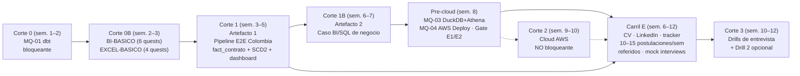
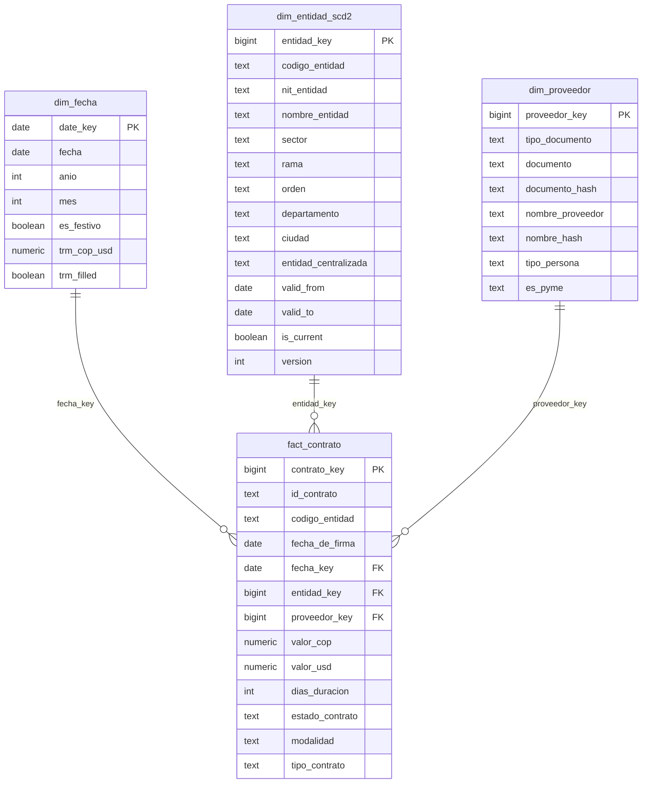

# Torre de Control y Roadmap de Ejecución — Ola 3 v2 (Empleabilidad Colombia: 2 Artefactos + Carril E + Cloud No Bloqueante)

> **Documento Rector:** [`meta/audits/2026-q3-contenido/analisis/dictamen-final-consolidado.md` (§4 — Ola 3)](file:///Users/ander/Documents/DoJo/DoJo_Study/meta/audits/2026-q3-contenido/analisis/dictamen-final-consolidado.md#L131-L136)  
> **Índice de la Ola 3:** [`README.md`](README.md)  
> **Protocolo de Generación y Gates:** [`system/docs/09-generation-protocol.md` (§3 Paso 7 y §4 Gates 1–5)](file:///Users/ander/Documents/DoJo/DoJo_Study/system/docs/09-generation-protocol.md#L218-L355)  
> **Especificación Curricular:** [`system/docs/05-syllabus-maestro.md` (§5–§7)](file:///Users/ander/Documents/DoJo/DoJo_Study/system/docs/05-syllabus-maestro.md#L170-L237)  
> **Plan de Empleabilidad:** [`empleabilidad-colombia.md`](empleabilidad-colombia.md)  
> **Prerrequisitos Superados:** Gate 1 (`57073c4`) + Gate 2 (`679a9d3` — **`130/130 tests passed` baseline**)  
> **Estado General:** 🟡 **EN EJECUCIÓN — Corte 0 (Semana 1); el Carril E arranca en la Semana 6**

---

## 1. Diagnóstico de la v2: qué cambió respecto a la Ola 3 anterior

La v2 nace de triangular tres análisis: el plan de empleabilidad para Colombia, una auditoría externa de gobernanza y una revisión técnica del roadmap. El objetivo ya no es solo “consolidar antes del portafolio”, sino **llegar a la primera oferta local en 4–7 meses**. Eso obliga a corregir cuatro cosas:

| Decisión | Ola 3 anterior | Ola 3 v2 |
|---|---|---|
| **Rol y BI** | Capstone narrado como “Data Engineer cloud”; sin BI | **Analytics Engineer / Data Analyst junior** + `BI-BASICO` (6 quests) + `EXCEL-BASICO` (4 quests) + métricas de negocio |
| **Fuentes** | World Bank + Frankfurter (BCE) | **`datos.gov.co`**: SECOP II (`jbjy-vk9h`) + TRM COP/USD con Socrata `$limit/$offset` y Ley 1581 |
| **Modelo** | `fact_trm` por fecha + `dim_entidad_scd2` sin un hecho que las una | **`fact_contrato`** a grano contrato + `dim_entidad_scd2` + `dim_fecha` con TRM |
| **Cloud** | Corte 2 bloqueante antes de publicar | **Corte 2 no bloqueante**, en paralelo a la búsqueda desde la Semana 9 |

**Hallazgos que justifican el cambio:**

1. **Frankfurter no sirve para un portfolio colombiano.** La API solo expone divisas del BCE y el BCE no publica EUR/COP. Verificado en `api.frankfurter.dev/v1/currencies`: no aparece COP.
2. **Power BI Desktop no corre nativo en macOS.** Se usa Power BI Desktop en una VM Windows (UTM/Parallels) o Windows 365; **Power BI Service no puede conectarse a un PostgreSQL local sin un on-premises data gateway**, que también es Windows-only. Si la VM falla, el respaldo es exportar los marts a CSV y usar Power BI Desktop o Looker Studio, manteniendo Power BI como keyword principal.
3. **El modelo estrella anterior no cerraba.** `fact_trm` tenía grano por fecha y `dim_entidad_scd2` describía entidades: ninguna clave las unía. El “cruce” del contexto de negocio era imposible de defender. **Esta revisión lo corrige** con un **hecho a grano de contrato** (`fact_contrato`, SECOP II) que se une a `dim_entidad_scd2` por la versión vigente a la fecha de firma y a `dim_fecha`, que lleva la TRM para convertir COP a USD.

**Corrección de Ley 1581:** se anonimizan identificadores de **personas naturales** (documento, nombre y NIT cuando la entidad sea persona natural); el **NIT de personas jurídicas se conserva** porque no es dato personal. La clave del SCD2 es `codigo_entidad`, no el NIT: hashear el NIT ya no rompe el join, pero se conserva para legibilidad legal y se publican agregados, no filas con NIT.

### 1.1 Arquitectura de la Ola 3 v2

**Regla de secuencia:** las postulaciones comienzan en la **Semana 9**, al cerrar el **Gate E1** al final de la Semana 8. La Semana 8 se dedica a MQ-03/MQ-04 (pre-cloud), al cierre del portafolio y al Gate E2. El Corte 2 empieza en la Semana 9, en paralelo a la búsqueda, y no bloquea postular.

---

## 2. Cobertura y fuentes

### 2.1 Corte 0 — 1 Micro-Quest bloqueante + 3 diferidas

| ID | Micro-Quest | Prioridad | Entregable | Uso posterior |
|---|---|---|---|---|
| **MQ-01** | **dbt-postgres** | **P0 bloqueante** | `dbt_project.yml`, `profiles.yml`, 2 modelos (`staging` → `marts`), `dbt run` + `dbt test` (`unique`, `not_null`) | Transformación del Corte 1 |
| **MQ-03** | **DuckDB + Glue/Athena fusionados** | P1 — **Semana 8** | SQL real sobre Parquet con DuckDB + contrato `boto3` de `glue.create_table` / `athena.start_query_execution` | Capa analítica del Corte 2 |
| **MQ-04** | **AWS Deploy + `teardown.py`** | P1 — **Semana 8** | 1 recurso aprovisionado, presupuesto `$1 USD`, destrucción verificada | Despliegue controlado del Corte 2 |
| **MQ-05** | **Airflow (equivalencia estructural)** | P1 no bloqueante | Contrato de DAG (`>>`, `default_args`, retries, cron) verificable por test | Filtro ATS; Prefect sigue siendo el motor operativo |

> **Cambio de la revisión:** MQ-03 y MQ-04 solo sirven al Corte 2, que no bloquea la postulación. Se mueven a la **Semana 8**, antes de abrir el cloud, para no gastar días de la ruta crítica en semanas 1–2. MQ-05 puede ejecutarse en cualquier momento y nunca bloquea. **Corte 0 solo cierra con MQ-01 en verde; BI y Excel pasan al Corte 0B.**

**Práctica transversal Semanas 1–2:** 20 ejercicios SQL cronometrados en voz alta (window functions, CTEs, deduplicación). Excel ya no es “repaso”: tiene chronicle propia en el Corte 0B.

### 2.2 Corte 0B — Nivelación de analista: `BI-BASICO` + `EXCEL-BASICO`

**Por qué existe.** El corpus de mercado que sostiene el plan (`meta/audits/mercado-laboral-consolidado-2026.md`) está scopeado a Data Engineer: no menciona Power BI ni Excel. El rol objetivo, en cambio, es **Analista de Datos / BI**, donde ambas son herramienta diaria y no diferenciador. Una sola Micro-Quest de 180 minutos no verifica ninguna de las dos: su DoD se podía cumplir con Looker Studio o con Excel. Ver §8 de ese documento.

**Dónde vive:** `content/subjects/analitica/chronicles/` (`BI-BASICO` y `EXCEL-BASICO`), no dentro de `DE-PIPELINES`. Son dominios distintos: modelado semántico y DAX no son ingeniería de datos.

| ID | Quest | Foco | Criterio de aceptación |
|---|---|---|---|
| **BI-00** | Power Query | Conectar a marts (Postgres o CSV), 5+ pasos documentados, cero limpieza manual | `query.pq` reproducible + captura de pasos |
| **BI-01** | Modelo semántico | Star schema: 1 hecho + 2 dims, relaciones 1:N, filtro unidireccional, tabla de fechas marcada | Diagrama del modelo + validación de cardinalidad |
| **BI-02** | DAX I | Medidas vs columnas calculadas, `CALCULATE`, `DIVIDE`, `SUMX` | 4 medidas con resultado reconciliado contra SQL |
| **BI-03** | DAX II | Inteligencia de tiempo: YoY, YTD, variación mensual | 3 medidas de tiempo sobre tabla de fechas |
| **BI-04** | Visualización y storytelling | 5 métricas, 3 hallazgos cuantificados, 1 recomendación | Dashboard de 1 página + guion de 5 min |
| **BI-05** | Publicación y seguridad | Refresh programado o manual documentado + 1 rol RLS de demo | Evidencia de refresh + captura de RLS |
| **XL-00** | Limpieza y estructura | Tablas estructuradas, `TRIM`/`TEXT`/fechas, quitar duplicados, validación | Libro `.xlsx` reproducible |
| **XL-01** | Búsqueda y lógica | `XLOOKUP` + `IFERROR`, `SUMIFS`/`COUNTIFS`, `IFS` | 3 casos resueltos sin `#N/A` |
| **XL-02** | Tablas dinámicas | Agrupar por fecha, % del total, campos calculados, segmentaciones, gráfico | Tabla dinámica que responde 1 pregunta de negocio |
| **XL-03** | Power Query + Power Pivot | Combinar/anexar consultas, cargar al modelo, 1 relación, 1 medida | Consulta que refresca + medida en el modelo |

> **Verificación:** estas 10 quests **no se validan con `pytest`** — no hay forma razonable de testear un `.pbix`. Se validan por **artefacto + defensa oral**: el `.xlsx`/`.pbix`, la captura del refresh y una explicación de 3–5 min del modelo y de una medida. Es la única desviación deliberada de la anatomía de quest con `test_mq_*.py`, y está declarada en cada `chronicle.md`.

> **Trade explícito:** `MQ-05` (Airflow) se degrada a conceptual —ya vive en `DE-PIPELINES` lore 05 como equivalencia de Prefect— y cede ~3 h. Corte 2 sigue no bloqueante. Neto: ~+5 h sobre la envolvente de 12 semanas, absorbidas en las Semanas 1–5.

### 2.3 Matriz de cobertura del `PORT-CAPSTONE` (Syllabus 3.0)

| Competencia | Corte 0 / 0B (sem. 1–3) | Pre-cloud (sem. 8) | Corte 1 / 1B | Corte 2 | Evidencia binaria / artefacto |
|---|---|---|---|---|---|
| **Python, Pydantic V2 y paginación HTTP** | — | — | ✅ | — | Ingesta Socrata (`$limit/$offset`) + fixtures y tests |
| **Data Quality y excepciones de dominio** | — | — | ✅ | ✅ | Gate pre-carga (`RateError`) + reconciliación post-carga |
| **PostgreSQL real + ACID (`ROLLBACK`)** | — | — | ✅ | — | Carga transaccional + Chaos Drill #1 (0 filas huérfanas) |
| **Star Schema + SCD Tipo 2** | — | — | ✅ | — | `fact_contrato` (grano `id_contrato`) + `dim_entidad_scd2` unida por versión vigente + `dim_fecha` con TRM |
| **dbt-postgres** | ✅ (`MQ-01`) | — | ✅ | — | `dbt run` + `dbt test` (`unique`, `not_null`, `relationships`) |
| **Excel (básico-medio)** | ✅ (`EXCEL-BASICO`) | — | ✅ | — | Libro con Power Query, tabla dinámica y `XLOOKUP` sin `#N/A` |
| **BI, métricas y storytelling** | ✅ (`BI-BASICO`) | — | ✅ | — | Modelo 1:N + 4 medidas DAX + YoY + dashboard con 3 insights y 1 recomendación cuantificada |
| **Orquestación (Prefect + equivalencia Airflow)** | — | Conceptual (`lore/05`) | ✅ | — | `@flow run_backfill(start_date, end_date)` idempotente |
| **Docker & `docker-compose.yml`** | — | — | ✅ | ✅ | `docker compose up` levanta PostgreSQL + pipeline |
| **AWS S3, IAM y Secrets Manager** | — | ✅ (`MQ-04`) | — | ✅ | Parquet Snappy, `AccessDenied`, secreto leído |
| **AWS Lambda, Glue, Athena y CloudWatch** | — | ✅ (`MQ-03/04`) | — | ✅ | Lambda invocada (opcional), tabla en Glue, 1 query Athena con coste acotado, alarma CW |
| **CI/CD y ENG-INT** | ✅ | ✅ | ✅ | ✅ | CI verde + post-mortems en inglés + Q&A + defensa oral |
| **Búsqueda, inglés y entrevistas** | — | — | — | — | Gates E1–E3 (§3.1) |

### 2.4 Contrato de fuentes colombianas (Corte 1)

| Fuente | Dataset / API | Uso | Nota técnica |
|---|---|---|---|
| **Contratos SECOP II** | `datos.gov.co` — `jbjy-vk9h` (5,69 M filas, actualización diaria; verificado 2026-11-11) | Hecho `fact_contrato` a grano `id_contrato` | Campos: `id_contrato`, `codigo_entidad`, `nit_entidad`, `fecha_de_firma`, `valor_del_contrato`, `estado_contrato`, `modalidad_de_contratacion`, `tipo_de_contrato`, `documento_proveedor`, `proveedor_adjudicado`. Socrata: `$select`, `$where`, `$order`, `$limit`, `$offset` |
| **TRM histórica COP/USD** | `datos.gov.co` — `32sa-8pi3` (8.385 fechas únicas, verificado 2026-11-11) o `djvb-n8kv` | Columna `trm_cop_usd` en `dim_fecha` | Campos `valor` (COP por USD) y `vigenciadesde`; serie por día hábil. Rellenar fines de semana/festivos con la última TRM y marcar `trm_filled=TRUE`. Sin ceros artificiales |
| **Catálogo de entidades** | Derivado de los atributos de entidad del propio SECOP II | `dim_entidad_scd2` | Snapshots mensuales por `codigo_entidad`; cambios de `nombre_entidad`, `sector`, `rama`, `orden`, `departamento`, `ciudad` o `entidad_centralizada` generan nueva versión |

**Alcance acotado del Corte 1 (para que sea ejecutable en 3 semanas):**

- Sector `Salud y Protección Social`.
- `fecha_de_firma` entre **2024-01-01** y **2026-10-31**.
- `valor_del_contrato > 0`.
- Volumen de referencia: **~426.000 contratos** al 2026-11-11 (el conteo cambia con la actualización diaria).
- Ingesta solo de las columnas del contrato, no de las 95 columnas del dataset.

**Claves y multiplicidad verificadas:**

- `codigo_entidad` identifica la unidad presupuestal/sucursal y es la **clave de negocio del SCD2**.
- `nit_entidad` identifica a la entidad legal y se conserva como **atributo** (hasheado si es persona natural), no como clave: un mismo NIT puede tener varias sucursales con `codigo_entidad` distinto (verificado con FONDANE: 6 códigos bajo el NIT `800072977`).
- El hecho se une a la dimensión por `codigo_entidad` y por rango de fechas (`fecha_de_firma` entre `valid_from` y `valid_to`).

**Regla de parada de paginación:** `offset += limit` hasta que el lote devuelto sea menor que `limit` o el conteo acumulado alcance el total reportado por la API. Guardar la primera y la última página como fixtures de test.

**Ley 1581:** usa `tipodocproveedor` para decidir: si es cédula/pasaporte, hash SHA-256 de `documento_proveedor` y del nombre; si es NIT, conserva el documento de la persona jurídica. Hashea `nombre_representante_legal` e `identificaci_n_representante_legal`. Para `nit_entidad`, conservar el NIT de **personas jurídicas** y hashear el identificador y el nombre cuando la entidad sea una **persona natural** (nombre de persona). Como SECOP no siempre trae un flag de tipo de persona para la entidad, se aplica una regla documentada + revisión manual antes de publicar. **No hashear** `codigo_entidad` (clave técnica del SCD2). En el repo público se publican agregados, no filas con NIT.

---

## 3. Gates, Stop Rules y definición de “listo para postular”

### 3.1 Gates por corte

* **Corte 0 (`MQ-01` dbt-postgres):** respeta la anatomía canónica del DoJo (`quest.md`, plantilla con `pass`, `reference/`, `test_mq_01_dbt.py`, actualización de `chronicle.md`, síntesis en `grimoire.md`). Pasa **Gate 3 (`Lore↔Grimoire`)** y **Gate 4 (`Quests↔Lore`)**. `MQ-03` y `MQ-04` son **pre-cloud de la Semana 8**; `MQ-05` (Airflow) queda degradado a conceptual (ya cubierto en `DE-PIPELINES` lore 05).
* **Corte 0B (`BI-BASICO` — 6 quests + `EXCEL-BASICO` — 4 quests):** viven en `content/subjects/analitica/chronicles/`. Pasan **Gate 3 (`Lore↔Grimoire`)** y se validan por **artefacto + defensa oral** (`.pbix`/`.xlsx` reproducible, captura de refresh/RLS, reconciliación de medidas DAX contra SQL y **rite de defensa de 5 min** explicando el modelo semántico, una medida DAX y por qué ese grano).
* **Corte 1 (Artefacto 1):** **Gate 1 (`Scope`)** con `requirements.md` aprobado antes de codificar. **Precondición obligatoria:** el `requirements.md` debe declarar el grano de `fact_contrato`, la clave de `dim_entidad_scd2`, la regla de join as-of y la fuente de TRM. Sin eso, el Corte 1 no se abre. **Gate 5 (`Auditoría Final`)** con suite de caja negra + Defensa Oral #1.
* **Corte 1B (Artefacto 2):** **Gate 5** con revisión de negocio: pregunta clara, SQL reproducible, dashboard y recomendación.
* **Carril E:** tres gates no técnicos:
  * **Gate E1 — Portafolio y perfil:** 2 artefactos publicados, README con impacto, CV de 1 página, LinkedIn ES/EN, 40 empresas objetivo y tracker.
  * **Gate E2 — Inglés B2 y defensa:** pitch de 90 s, explicación de SCD2/idempotencia/Star Schema en <3 min, demo grabada de 3–5 min en español e inglés.
  * **Gate E3 — Entrevistas:** SQL cronometrado + take-home + caso + behavioral + simulacro de negociación aprobados.
* **Corte 2 (Cloud):** **Gate 5** sobre el núcleo S3/IAM/Secrets/`teardown.py`. **No bloquea** el inicio de postulaciones.

### 3.2 Stop Rules

* **Corte 0 y Corte 0B:** la regla de **180 minutos por quest** se mantiene intacta tanto para `MQ-01` como para cada una de las 6 quests de `BI-BASICO` y las 4 quests de `EXCEL-BASICO` (lo que cambia es el número de quests, no el límite por quest). Si una quest supera 180 minutos, se detiene y se amplía el lore/andamiaje. La instalación de la VM Windows y de Power BI Desktop **no cuenta** en ese límite: es un prerrequisito de entorno que debe estar listo (con snapshot) antes de abrir `BI-BASICO`.
* **Corte 1:** si supera **3 semanas**, se congela alcance accesorio y se prioriza el DoD. El alcance de datos ya está acotado a salud 2024–2026.
* **Corte 1B:** máximo **5 días de trabajo efectivo**; la ventana de calendario es Semanas 6–7 porque comparte tiempo con el Carril E. Si se extiende, se reduce a un dashboard + 3 hallazgos.
* **Corte 2:** máximo **3 semanas**; si se extiende, se limita a S3 + IAM + `teardown.py` (y puede correrse a después de la Semana 10 si hace falta).
* **Stop Rule Empleabilidad:** **ninguna tarea técnica puede recortar las 10 postulaciones semanales** desde la Semana 9. Si hay conflicto, se recorta alcance técnico, no búsqueda.

---

## 4. Especificación de los cortes

### 🛠️ CORTE 0 — Nivelación operativa de transformación: `dbt-postgres` (Semana 1)

* **Objetivo:** que `dbt-postgres` no se ejecute por primera vez dentro del proyecto integrador (`Rite ⊆ Lore + Quest`, `Zero Surprise Syntax`), y dejar preparado el entorno de BI antes de abrir el Corte 0B.
* **Entregable bloqueante:** `MQ-01` (`dbt-postgres`). `MQ-03`/`MQ-04` se ejecutan en la Semana 8 como pre-cloud; `MQ-05` (Airflow) se degrada a conceptual (ya cubierto en `DE-PIPELINES` lore 05, cediendo ~3 h al Corte 0B).
* **Prerrequisito de entorno para el Corte 0B:** VM Windows (UTM/Parallels/Windows 365) con **Power BI Desktop** instalado, **snapshot de VM guardado** y acceso al PostgreSQL del host (o flujo de exportación de marts a CSV). Power BI Service no puede conectarse a un PostgreSQL local sin gateway on-prem, y el gateway es Windows-only. **La VM se prepara en la Semana 1 antes de empezar `BI-BASICO`**, fuera del límite de 180 minutos por quest.
* **DoD del Corte 0:**
  1. CI verde con `test_mq_01_dbt.py` descubierto y pasando.
  2. `dbt run` + `dbt test` (`unique`, `not_null`) en verde sobre PostgreSQL.
  3. 20 ejercicios SQL resueltos sin apuntes (window functions, CTEs, deduplicación).
  4. VM de Power BI operativa con snapshot y documentada (versión de Windows, Power BI Desktop y método de conexión Postgres/CSV).

> **Fuera de este corte:** `BI-BASICO` y `EXCEL-BASICO` (pasan al Corte 0B con entidad propia en `content/subjects/analitica/chronicles/`), y `DuckDB/Athena` + despliegue AWS/`teardown.py` (se hacen en la Semana 8, antes del Corte 2).

---

### 📊 CORTE 0B — Nivelación de analista: `BI-BASICO` (6 quests) + `EXCEL-BASICO` (4 quests) (Semanas 2–5)

* **Objetivo:** cubrir con profundidad real y verificable las dos herramientas diarias del rol de entrada (**Analista de Datos / Analytics Engineer junior**), evitando el defecto de una quest genérica que podría aprobarse sin tocar modelo semántico, DAX ni Power Query.
* **Ubicación:** `content/subjects/analitica/chronicles/BI-BASICO/` y `content/subjects/analitica/chronicles/EXCEL-BASICO/` (dominio independiente de `DE-PIPELINES`, con techo declarado **"básico"**; Fabric/Premium permanecen en Fase 2).
* **Presupuesto y reparto horario:** 20–24 h para `BI-BASICO` (estructurando las horas que antes estaban sin contenido entre `MQ-02` y los dos dashboards) y 15–20 h para `EXCEL-BASICO`, financiadas en parte por la degradación de `MQ-05` Airflow (−3 h) y manteniendo el límite estricto de **180 minutos por quest**.
* **Mitigación de fricción en macOS:** mantener la VM Windows con snapshot listo, exportar los marts a CSV para iterar rápido sin pelear con el gateway en cada sesión, y consolidar el `.pbix` al cierre de cada quest.
* **Secuencia de ejecución acoplada al portafolio:**
  * **Semana 2 (Base antes del Corte 1):** `BI-00` (Power Query), `BI-01` (Modelo semántico Star Schema 1:N, filtro unidireccional, tabla de fechas marcada), `BI-02` (DAX I: medidas vs columnas calculadas, `CALCULATE`, `DIVIDE`, `SUMX`) + `XL-00` (Limpieza/tablas estructuradas), `XL-01` (`XLOOKUP` + `IFERROR`, `SUMIFS`/`COUNTIFS`, `IFS`), `XL-02` (Tablas dinámicas).
  * **Semanas 3–5 (Aplicadas sobre los marts reales del Corte 1):** `BI-03` (DAX II: YoY, YTD, variación mensual reconciliados contra SQL), `BI-04` (Visualización y storytelling: 5 métricas, 3 hallazgos, 1 recomendación), `BI-05` (Publicación, refresh documentado y 1 rol RLS de demo) + `XL-03` (Power Query + Power Pivot con relación y medida).
* **DoD del Corte 0B (Artefacto + Rite de Defensa Oral):**
  1. `BI-00` a `BI-05` completadas con archivo `.pbix`, `query.pq` reproducible, diagrama del modelo 1:N, 7 medidas DAX (`CALCULATE`, `DIVIDE`, `SUMX`, YoY, YTD, variación mensual) reconciliadas contra SQL y captura de refresh/RLS.
  2. `XL-00` a `XL-03` completadas en libro `.xlsx` reproducible sin errores `#N/A`, con tabla dinámica, consulta Power Query que refresca y medida en Power Pivot.
  3. **Rite de Defensa Oral (5 min):** explicar en vivo el modelo semántico, una medida DAX (y su contexto de filtro) y por qué se eligió ese grano.

---

### 🥉 CORTE 1 — Artefacto 1: Pipeline E2E sobre datos de Colombia (Semanas 3–5)

* **Pregunta de negocio:** ¿cómo evolucionó el gasto público contratado en el sector salud entre 2024 y 2026, y qué parte de la variación se explica por tipo de entidad, modalidad de contratación y TRM?
* **Ubicación interna:** `content/portfolio/capstone-slice-local/` (documentada en `content/subjects/README.md` y cubierta por CI).
* **Precondición de Gate 1:** el `requirements.md` debe copiar el modelo dimensional de esta sección, declarar el grano, las claves, la regla de join as-of y la fuente de TRM. **Sin este requisito aprobado no se abre el Corte 1.**

#### Modelo dimensional objetivo (contrato de Gate 1)

**Grano:** una fila por `id_contrato`.

**Reglas de integridad que el `requirements.md` debe fijar:**

1. `fact_contrato.id_contrato` es único (constraint + `dbt test` + caja negra).
2. En staging se resuelve `entidad_key` con `fact.codigo_entidad = dim.codigo_entidad` y `fact.fecha_de_firma::date between dim.valid_from and dim.valid_to`. El hecho conserva `codigo_entidad`, `fecha_de_firma` (cast a date) y `fecha_key` como dimensiones degeneradas para trazabilidad y tests. Cada hecho se une a **exactamente una** versión de la dimensión: cero hechos huérfanos y cero duplicados por join.
3. `dim_entidad_scd2` tiene **una sola** fila `is_current=TRUE` por `codigo_entidad`; intervalos no solapados y sin huecos dentro de la ventana observada.
4. `dim_fecha.trm_cop_usd` cubre todas las fechas de firma. Fines de semana/festivos usan la última TRM disponible con `trm_filled=TRUE`; nunca se rellena con cero.
5. `valor_usd = round(valor_cop / trm_cop_usd, 2)` y se reconcilia contra `valor_cop` con tolerancia documentada.
6. `dim_entidad_scd2` conserva el NIT de personas jurídicas; si la entidad es una persona natural, hashea `nit_entidad` y `nombre_entidad`. `dim_proveedor` aplica la misma regla: hash SHA-256 para documento y nombre de personas naturales.
7. `dim_proveedor` incluye una fila `Unknown` (`proveedor_key = -1`) para contratos sin documento; `fact_contrato.proveedor_key` nunca es nulo.

**Cómo se construye el SCD2 (para que sea real, no decorativo):**

1. Snapshot mensual: por `codigo_entidad` y mes, tomar el último contrato firmado en ese mes y sus atributos de entidad.
2. Colapsar meses consecutivos con atributos idénticos en una sola versión.
3. `valid_from` = primer día del mes de la primera observación de la versión; `valid_to` = día anterior al inicio de la siguiente versión; la última versión termina en `9999-12-31` e `is_current=TRUE`.
4. Caso real observado: INVIMA presenta variación de `entidad_centralizada` en la ventana; el snapshot mensual la resuelve tomando el último contrato del mes. Además, el test simula un cambio controlado para cubrir el caso aunque el dataset no lo traiga.
5. La clave es `codigo_entidad`, no el NIT: un NIT puede tener varias sucursales (FONDANE tiene 6 códigos bajo `800072977`). El NIT queda como atributo para no romper la lectura legal.
6. **Supuesto documentado:** los atributos de entidad se capturan al momento de la firma/publicación del contrato. Si SECOP los sobrescribe retroactivamente, el snapshot mensual refleja el último valor conocido; se declara como límite en el README y se valida con una muestra de entidades con más de una versión.

**Data Contract mínimo (SECOP II + TRM):**

| Campo | Tipo | Nulo | Regla |
|---|---|---|---|
| `id_contrato` | text | no | Clave del hecho; **verificado único en la ventana (426.459/426.459 al 2026-11-11)**. Si una actualización futura lo repite, se conserva la versión con `ultima_actualizacion` más reciente y se registra el descarte |
| `codigo_entidad` | text | no | Clave de la dimensión SCD2 |
| `nit_entidad` | text | no | Se conserva si es persona jurídica; se hashea junto con `nombre_entidad` si es persona natural. `codigo_entidad` sigue siendo la clave técnica |
| `fecha_de_firma` | date | no | Grano temporal; alimenta `fecha_key` |
| `valor_del_contrato` | numeric | no | `>= 0`; los negativos o nulos se rechazan a cuarentena |
| `documento_proveedor` | text | sí | Hash si es persona natural; se conserva si es persona jurídica |
| `estado_contrato`, `modalidad_de_contratacion`, `tipo_de_contrato` | text | sí | Se normalizan a mayúsculas y se documentan los valores “No Definido” |

**5 métricas de negocio:**

1. Valor contratado total en COP y USD por año/mes.
2. Número de contratos y ticket promedio (COP/USD).
3. Participación del valor por modalidad de contratación (directa vs concurso).
4. Concentración de proveedores (top 10 y HHI).
5. Variación interanual del gasto en USD y descomposición aproximada entre volumen y TRM.

**Artefactos del protocolo (`docs/09` Paso 7):**

1. `requirements.md`: PRD con business context, modelo dimensional de este roadmap, Data Contract de las 2 fuentes, paginación Socrata, criterio de parada, campos, tipos, nulos y fases.
2. `journal.md`: decisiones, fronteras de mocking, **Post-Mortem #1 en inglés** y primeras 5 Q&A.
3. Suite de aceptación de caja negra en `meta/ola-3/acceptance/test_corte1_blackbox.py`, fuera del árbol editable y con checksum SHA-256 en CI.

* **Alcance técnico:**
  * **Hecho:** SECOP II `jbjy-vk9h`, sector salud, 2024-01-01 a 2026-10-31, `valor_del_contrato > 0`.
  * **Dimensión SCD2:** entidades derivadas de los atributos del propio SECOP II, versionadas por mes.
  * **Dimensión fecha:** calendario + TRM histórica COP/USD.
  * **PostgreSQL + dbt-postgres** (`staging` → `marts`), **Prefect** como orquestador único y **Docker Compose**.
  * **Dashboard + README bilingüe** con impacto cuantificado.

* **DoD binario (8 criterios + defensa oral):**
  1. `run_backfill(start_date, end_date)` idempotente: 2 ejecuciones → mismo conteo, 0 duplicados.
  2. `fact_contrato` con grano único `id_contrato`, verificado por constraint, `dbt test` y caja negra.
  3. Cero hechos huérfanos: todo `fact_contrato` tiene una fila en `dim_entidad_scd2` y una en `dim_fecha`, y la versión apuntada por `entidad_key` cubre `fecha_de_firma`.
  4. `dim_entidad_scd2` con exactamente **un `is_current=TRUE`** por `codigo_entidad`, intervalos no solapados, tras simular un cambio.
  5. TRM cubierta para todas las fechas de firma; `valor_usd` reconciliado con `valor_cop / trm`.
  6. `docker compose up` levanta PostgreSQL + pipeline y ejecuta `dbt run` + `dbt test` con `exit code 0`.
  7. **Chaos Drill #1:** fallo a mitad de carga → `ROLLBACK` atómico, 0 filas huérfanas + Post-Mortem #1 en inglés.
  8. **Dashboard + métricas:** 3 insights y 1 recomendación defendibles + **Defensa Oral #1 (10 min)** en español e inglés, incluyendo “¿por qué el hecho es a grano contrato y no a grano fecha?”.

---

### 🥈 CORTE 1B — Artefacto 2: Caso de negocio SQL + BI (Semanas 6–7)

* **Objetivo:** demostrar el perfil que realmente contrata Colombia: **Analista de Datos / Analytics Engineer junior**.
* **Ubicación interna:** `content/portfolio/caso-bi-colombia/`.
* **Duración:** 3–5 días de trabajo efectivo.
* **Pregunta de negocio (elegir una):** morosidad de cartera, cohortes de retención, embudo de pagos, accidentalidad o precios de vivienda. Si reutilizas SECOP II, la pregunta debe ser distinta a la del Corte 1 y el SQL debe ser independiente: no es una copia del dashboard del pipeline. Reutiliza directamente la arquitectura del modelo semántico y medidas DAX construidas en las quests `01`–`04` de `BI-BASICO`.
* **Entregables:**
  1. SQL analítico reproducible (CTEs, window functions, cohortes/variación).
  2. Dashboard con 3 hallazgos cuantificados y 1 recomendación accionable.
  3. README corto con pregunta, datos, método, resultados y límites.
  4. Nota de Ley 1581 (anonimización de personas naturales; NIT conservado).
* **DoD:**
  1. Pregunta de negocio explícita y respondible con los datos.
  2. SQL ejecutable de punta a punta con instrucciones.
  3. Dashboard funcional y legible.
  4. Conclusiones defendibles sin mirar el código.
  5. Repo público enlazado desde el perfil y el CV (§6.4).

---

### 🚀 CARRIL E — Motor de empleabilidad (Semanas 6–12, en paralelo)

* **Semana 6–8 — Gate E1 (Portafolio y perfil):**
  * Publicar los 2 artefactos en el repo público según §6.4 (públicos o compartibles).
  * CV de 1 página con keywords ATS locales (SQL, Python, Power BI, Excel, dbt, PostgreSQL, AWS).
  * LinkedIn ES/EN con titular de Analista de Datos / Analytics Engineer.
  * Lista de 40 empresas objetivo + tracker de postulaciones.
  * **La Semana 8 cierra E1; las postulaciones empiezan en la Semana 9, no antes.**
* **Semana 8 — Gate E2 (Inglés y defensa):**
  * Guion de 90 s (“cuéntame de ti” / “háblame de tu proyecto”) en español e inglés.
  * Explicación en <3 min de SCD2, idempotencia, Star Schema y por qué el hecho es a grano contrato.
  * Demo grabada de 3–5 min.
  * En paralelo, MQ-03/MQ-04 (pre-cloud) ocupan como máximo 2 días.
* **Semana 9–12 — Gate E3 (Búsqueda y entrevistas):**
  * 10–15 postulaciones personalizadas/semana.
  * 3–5 contactos de referido/semana.
  * 5 h/semana de inglés técnico.
  * 1 mock interview/semana.
  * Simulacro de negociación salarial en la Semana 12.

> El detalle operativo (canales, guiones, salarios y checklist) vive en [`empleabilidad-colombia.md`](empleabilidad-colombia.md). Este roadmap solo fija fechas y gates.

---

### 🥇 CORTE 2 — Cloud AWS (Semanas 9–10, en paralelo, NO bloqueante)

* **Prerrequisito:** MQ-03 y MQ-04 cerradas en la Semana 8. Si no están, el Corte 2 se retrasa; las postulaciones no.
* **Núcleo obligatorio (diferenciador):**
  1. Bucket S3 con nombre DNS válido.
  2. Parquet Snappy en `io.BytesIO`, legible sin índice residual.
  3. Política IAM con `Explicit Deny` sobre borrado, verificada con `AccessDenied`.
  4. Credenciales desde Secrets Manager en el código del pipeline; **sin `.env` versionado ni empaquetado en artefactos desplegables** (aplica a Lambda si se implementa y a cualquier ejecución local/CI).
  5. `teardown.py` idempotente con 0 recursos facturables.
* **Opcional (a tu ritmo, mientras ya tienes entrevistas):** Lambda `.zip`, tabla en Glue, 1 query real en Athena con **coste acotado a <$1 USD** (Athena cobra USD 5/TB escaneado y **no tiene free tier**), Metric Filter + CloudWatch Alarm, Chaos Drill #2.
* **DoD:** los 5 criterios del núcleo + `teardown.py` verificado. Los opcionales no bloquean la postulación.

---

### 🎯 CORTE 3 — Drills de entrevista y remediación (Semanas 10–12)

* **Simulacros cronometrados de las 5 etapas reales:**
  1. Prueba SQL en vivo (10 ejercicios, 45 min).
  2. Take-home de 3–4 h con README y supuestos.
  3. Caso de negocio (métricas, segmentación, trade-offs).
  4. Behavioral STAR (conflicto, aprendizaje, trabajo en equipo).
  5. Simulacro de negociación salarial.
* **Remediación guiada por rechazos:** el Drill 2 (`§3.2` del dictamen) solo se activa sobre el patrón real de rechazo de las Semanas 9–10, no por intuición.
* **Criterio de cierre:** 3 simulacros aprobados y una banda salarial definida.

---

## 5. DoD de Empleabilidad (cierre de la Ola 3 v2)

1. 2 artefactos publicados en el repo público (§6.4) y defendibles (Corte 1 + Corte 1B).
2. CV y LinkedIn listos, con keywords y nivel de inglés declarado.
3. 40 aplicaciones enviadas y 10 contactos de referido.
4. 3 entrevistas reales o simuladas aprobadas.
5. Pitch de 90 s y demo de 5 min en español e inglés.
6. Banda salarial definida y guion de negociación.

---

## 6. Gobernanza, dependencias y riesgos

### 6.1 Documentos sincronizados

* `meta/ola-3/roadmap.md` (este documento).
* `meta/ola-3/README.md`: índice operativo de la Ola 3.
* `meta/remediacion/README.md`: índice de la remediación cerrada (Ola 1 y Ola 2); contexto histórico de la Ola 3.
* `system/docs/05-syllabus-maestro.md` §2 y §5–§7: `BI-BASICO` (6 quests) + `EXCEL-BASICO` (4 quests) en `analitica/chronicles/`, 2 artefactos, modelo dimensional y gate de búsqueda local.
* `meta/ola-3/empleabilidad-colombia.md`: estado real de dbt/capstone, nivelación `BI-BASICO`/`EXCEL-BASICO`, fuentes colombianas, Power BI en VM y publicación por allowlist.

### 6.2 Riesgos y mitigaciones

| Riesgo | Mitigación |
|---|---|
| Power BI Service no se conecta a un PostgreSQL local | Power BI Desktop en VM Windows (UTM/Parallels/Windows 365) con acceso al Postgres del host, o exportación de marts a CSV. **Preparar la VM (con snapshot) antes de abrir `BI-BASICO` (Corte 0B)**; la instalación no cuenta en el límite de 180 min |
| Fricción de arrancar la VM Windows en 6 quests de BI | Dejar la VM con snapshot listo, exportar los marts a CSV para no pelear con el gateway en cada iteración, y consolidar el `.pbix` al cierre de cada quest |
| El SCD2 tiene pocos cambios reales en la ventana | Snapshot mensual + colapso de versiones + un caso real observado (INVIMA) + test sintético de cambio. Documentar que la ventana observada empieza en 2024-01-01 |
| El dataset de SECOP II cambia o no pagina como se espera | Verificar `jbjy-vk9h` y su metadata antes de codificar; `$select` acotado, `$where` por sector/fecha, `$limit/$offset` + criterio de parada; fixture de la primera y última página |
| El alcance de 426k contratos desborda el Corte 1 | El alcance ya está acotado a salud 2024–2026 y a las columnas del contrato. Si el volumen frena la ingesta, reducir a 2025–2026 y documentarlo como límite |
| Anonimización mal aplicada | Hash solo de personas naturales; NIT y `codigo_entidad` conservados; checklist Ley 1581 antes de publicar |
| La publicación expone secretos o datos personales | Exportación por allowlist, denylist de `.env`/`data/`, `gitleaks` o `git secrets` y revisión manual antes del push |
| El cloud consume la búsqueda | Corte 2 no bloqueante + Stop Rule Empleabilidad |
| El portfolio se percibe como tutorial | Datos colombianos, tests, chaos drill, README con impacto y defensa oral |

### 6.3 Qué NO se toca

Se mantienen intactos: dbt, PostgreSQL, SCD2, DQ, Chaos Drill, acceptance tests, `teardown.py` y defensa oral. Son el diferenciador frente al bootcamp promedio.

### 6.4 Publicación de los 2 artefactos (Gate E1)

* **Fuente de verdad interna:** el monorepo, en `content/portfolio/capstone-slice-local/` (Artefacto 1) y `content/portfolio/caso-bi-colombia/` (Artefacto 2).
* **Repo público sugerido:** uno solo, `github.com/01Ander/portafolio-datos-colombia`, con dos carpetas (`01-pipeline-secop-trm/`, `02-caso-bi-negocio/`) y un README raíz que enlace ambos. Un solo enlace es más fácil de poner en el CV y en LinkedIn; si prefieres dos repos, el Gate E1 exige los dos enlaces.
* **Mecanismo de exportación:** un script `scripts/export_public.sh` (se crea al cerrar el Corte 1B) que copia por **allowlist** (`README.md`, `src/`, `tests/`, `models_dbt/`, `docker-compose.yml`, `.github/workflows/`, fixtures mínimos) a un directorio staging y hace el commit/push al repo público. No se publica el monorepo completo ni el historial interno.
* **Denylist obligatoria:** `.env`, `data/`, `*.parquet` crudos, credenciales, `journal.md` sin sanitizar, acceptance tests con checksums y cualquier documento de auditoría interno.
* **Checklist antes del push:** `gitleaks detect` (o `git secrets --scan`), búsqueda de cédulas/nombres de personas naturales, verificación de que el README arranca con `docker compose up`, y confirmación de que los 2 enlaces responden en incógnito.
* **Evidencia de Gate E1:** URL pública de cada artefacto + captura de que el README se renderiza + `PUBLICAR.md` con el checklist firmado (se crea junto con el script).

---

## 7. Línea de tiempo resumida

| Semana | Técnico | Empleabilidad |
|---|---|---|
| 1 | Corte 0: MQ-01 (dbt) + entorno VM Power BI (con snapshot) + 20 ejercicios SQL | Diagnóstico y keywords de vacantes reales |
| 2 | Corte 0B (inicio): `BI-BASICO` `00`–`02` + `EXCEL-BASICO` `00`–`02` | — |
| 3–5 | Corte 1: Artefacto 1 (`fact_contrato` + SCD2 + dashboard) + cierre Corte 0B (`BI-BASICO` `03`–`05` + `EXCEL-BASICO` `03`) | — |
| 6–7 | Corte 1B: Artefacto 2 (caso BI sobre modelo semántico de `BI-BASICO`) | Gate E1 en preparación: repo, CV, LinkedIn, tracker |
| 8 | MQ-03/MQ-04 (pre-cloud) + cierre de artefactos | **Gate E1 + Gate E2**; aún no se postula |
| 9–10 | Corte 2 (núcleo cloud) en paralelo | **Inicio de postulaciones**: 10–15/semana + mock interviews |
| 10–12 | Corte 3: drills de entrevista | Gate E3 + negociación |

> **Semana 12+:** el Drill 2 solo se activa si hay un gap real detectado en las entrevistas; no es una fase planificada.
