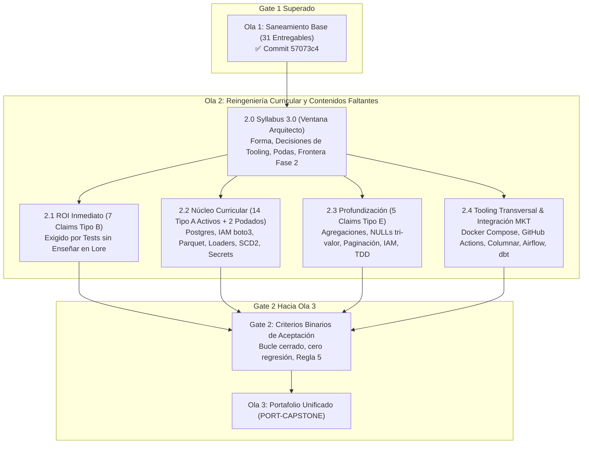

# Torre de Control y Roadmap de Remediación — Ola 2 (Syllabus 3.0 & Contenidos Faltantes)

> **Documento Rector:** [`meta/audits/2026-q3-contenido/analisis/dictamen-final-consolidado.md`](file:///Users/ander/Documents/DoJo/DoJo_Study/meta/audits/2026-q3-contenido/analisis/dictamen-final-consolidado.md)  
> **Ubicación Canónica de Gobernanza:** `meta/remediacion/`  
> **Estado General:** Fase de Arquitectura y Diseño Curricular (Syllabus 3.0)  
> **Fecha de Inicio:** 2026-10-13  
> **Prerrequisito Aprobado:** Gate 1 (Ola 1 cerrada al 100% en commit `57073c4`)

---

## 1. Misión y Alcance de la Ola 2

Habiendo saneado la totalidad de la base de código y eliminado los bloqueos mecánicos en la Ola 1 (31 entregables), la **Ola 2** tiene como objetivo **cerrar la brecha de contenido faltante (28 claims de auditoría) e incorporar los requerimientos obligatorios fijados por el mercado laboral internacional 2026 (los 8 CLAIM-MKT)**.

---

## 2. Los 4 Pilares del Prerequisito: `Syllabus 3.0` (Ventana de Arquitecto)

Tal como lo dictamina la sección 4.2 del Dictamen Rector, antes de escribir una sola línea de contenido nuevo se resuelven las decisiones estructurales:

### 2.1 Decisión de Forma: Integración Natural vs Asignatura Aislada
* **Dictamen:** No fragmentar el aprendizaje en cursos hiper-específicos que aumenten la dispersión del Operador. El mercado pide que la cadena de datos funcione, no un catálogo de cursos introductorios.
* **Resolución:** **Integración en la Cadena Existente**:
  * **PostgreSQL real:** Se incorpora como motor de carga destino en `DE-PIPELINES` y motor relacional en `CLOUD-AWS` (RDS), desplazando el monocultivo de SQLite hacia pruebas unitarias en memoria.
  * **Warehouse Columnar (Snowflake / BigQuery / Redshift):** Se integra en el tramo analítico avanzado de `DE-PIPELINES` como destino de datos curados previo al Capstone.
  * **dbt:** Se integra en `DE-PIPELINES` para la capa de transformación declarativa y modelado SQL modular.
  * **AWS Glue + Athena:** Se incorporan en la sección analítica de `CLOUD-AWS`.
  * **Airflow básico:** Se enseña en `DE-PIPELINES` como estándar de referencia ATS (DAGs, dependencias `>>`, scheduler, reintentos).
  * **Docker pragmático:** Se adopta como tooling transversal para levantar Postgres y servicios locales sin fricción de instalación en el host.

### 2.2 Derogación de Contradicciones Históricas
* **Contenerización (Docker):** El `Protocol Yellow` trataba a Docker como complejidad opcional. El análisis de mercado laboral 2026 demuestra que Docker (`Dockerfile` y `docker-compose.yml`) es una expectativa pre-empleo básica. Se formaliza como herramienta transversal estándar del DoJo.
* **Spark:** El mercado le asigna un 33% sin declararlo obligatorio pre-empleo. Se define como lectura conceptual de arquitectura en `DE-PIPELINES` y se delega la práctica pesada a la Fase 2 (Post-empleo).

### 2.3 Formalización de Podas Curriculares (Las 3 Excepciones)
1. **Typer/Click (`PY-012`, Tipo A):** Queda formalmente podado a favor de `argparse` (ya enseñado y reconciliado en el Chronicle).
2. **Clean Architecture (`PY-015`, Tipo A):** Se redefine en el temario como "Diseño Modular por Capas y Separación de Responsabilidades", descartando dogmas teóricos que no aportan al rol de Data Automation.
3. **`load_dotenv` en Lambda:** Se erradica de las guías de Lambda; se enseña el estándar de producción: variables de entorno inyectadas por AWS Cloud y roles de ejecución IAM.

### 2.4 Delimitación de Frontera con Fase 2 (Post-Empleo RFC v5.2.0)
Para evitar la proliferación descontrolada de temas que retrasen la inserción laboral del Operador, se blinda el alcance pre-empleo conforme al RFC v5.2.0:
* **Dentro de Ruta Pre-Empleo (Ola 2 y Capstone):** Python OOP/TDD, SQL/PostgreSQL, Pandas, Docker local, Airflow/Prefect, S3/Parquet, IAM básico, RDS, Lambda, CloudWatch, dbt básico, Cloud Warehouse básico, Secrets Manager y CI con GitHub Actions.
* **Fase 2 (Post-Empleo — Retenido según validación propia):** QA formal exhaustivo, DevOps avanzado (Kubernetes, Terraform, CI/CD multi-ambiente), Dashboards complejos / BI, Seguridad y gobernanza corporativa avanzada, y LLM/RAG/GenAI (~9% de ofertas iniciales).

---

## 3. Matriz Maestra de Claims a Cerrar en Ola 2 (28 Claims de Auditoría + Integración MKT)

> **Trazabilidad Aritmética de los 28 Claims de Contenido Faltante:**  
> **7 Tipo B** (Bloque 3.1) + **14 Tipo A activos** (Bloque 3.2) + **2 Tipo A podados** (`PY-012` y `PY-015` en §2.3) + **5 Tipo E** (Bloque 3.3) = **28 Claims de Auditoría** (100% de cobertura).

### 3.1 Bloque 2.1 — ROI Inmediato (Los 7 Tipo B: Exigidos sin Enseñar)
*Son conceptos que el Rite o los tests ya evalúan pero que el Lore nunca explicó. Tienen el ratio esfuerzo/beneficio más alto.*

| Claim ID | Subject | Componente | Concepto Faltante | Estrategia Pedagógica | Carril |
|---|---|---|---|---|---|
| **`PY-016`** | `02-py-poo` | Lore 03 / Rite | `collections.defaultdict` | Añadir sección en Lore 03 con Domain Shifting y ejercicio rápido | B (Lore) / A (Quest) |
| **`PY-017`** | `02-py-poo` | Lore 05 / Tests Rite | Fixture `tmp_path` de `pytest` | Explicar gestión de directorios efímeros para tests aislados | B (Lore) / A (Quest) |
| **`PY-018`** | `02-py-poo` | Lore 05 / Tests Rite | `pytest.approx` | Explicar precisión de punto flotante en aserciones numéricas | B (Lore) / A (Quest) |
| **`PY-019`** | `02-py-poo` | Lore 05 / Quest 03 | `@pytest.fixture` | Formalizar fixtures reutilizables en suite de pruebas | B (Lore) / A (Quest) |
| **`SQL-012`**| `03-sql-basico` | Lore 04 / Rite | Cardinalidad N:M y "Autor Principal" | Explicar modelado de relaciones N:M y resolución determinista | B (Lore) / A (Quest) |
| **`DE-006`** | `04-de-pipelines` | Lore 02 / Rite | `df.groupby` en Pandas | Añadir agregaciones y agrupamiento relacional en DataFrames | B (Lore) / A (Quest) |
| **`DE-010`** | `04-de-pipelines` | Lore 01 / DoD Rite | `mypy` en Data Pipelines | Guía rápida de tipado estricto en pipelines de datos | B (Lore) / A (Quest) |

---

### 3.2 Bloque 2.2 — Núcleo Curricular (14 Tipo A Activos + 2 CLAIM-MKT Integrados)

> *Nota de Trazabilidad:* Los 2 Tipo A restantes (`PY-012` y `PY-015`) quedan formalmente cerrados por poda arquitectónica en §2.3.

| Claim ID | Subject | Promesa en Temario | Brecha Detectada | Entregable Ola 2 | Carril |
|---|---|---|---|---|---|
| **`PY-010`** | `02-py-poo` | Cap 02: Constructores con `super()` | Solo herencia básica sin delegación de inicializadores | Lore + Quest con jerarquías compuestas usando `super().__init__()` | B/A |
| **`PY-011`** | `02-py-poo` | Cap 06: Validación con Pydantic | Pydantic prometido pero no enseñado | Lore de modelos Pydantic + Quest de validación de esquemas | B/A |
| **`PY-013`** | `02-py-poo` | Cap 04: "Output Loaders" | Patrón Loader ausente | Quest modular con clase abstracta `BaseLoader` y subclases | B/A |
| **`PY-014`** | `02-py-poo` | Fase 1 Rite: `JSONExtractor` | Clase abstracta omitida | Quest/Andamiaje que modele la extracción desacoplada | B/A |
| **`SQL-005`** | `03-sql-basico` | Cap 08: `ROLLBACK` y ACID | Transacciones explicadas superficialmente sin práctica | Quest con transacciones explícitas (`BEGIN`, `COMMIT`, `ROLLBACK`) | B/A |
| **`DE-004`** | `04-de-pipelines` | Cap 04: Carga a PostgreSQL | Sustituido por SQLite en el 100% de ejercicios | Quest con PostgreSQL real (vía Docker) usando SQLAlchemy/psycopg | B/A |
| **`DE-005`** | `04-de-pipelines` | Cap 05: Orquestación Periódica | Scheduling con Prefect/Airflow ausente | Implementación de scheduler periódico y reintentos automáticos | B/A |
| **`DE-009`** | `04-de-pipelines` | Cap 05: Logs de ejecución | Reemplazado por `print()` | Integración de logger de orquestación (`get_run_logger` / logging estructurado) | B/A |
| **`AWS-004`** | `05-cloud-aws` | Cap 00: IAM Programático | Solo verificación de roles preexistentes | Quest con `boto3` para crear roles, policies y trust relationships | B/A |
| **`AWS-005`** | `05-cloud-aws` | Cap 01: Creación de Buckets | Solo upload a buckets creados en setup | Quest de aprovisionamiento `create_bucket` con validación DNS | B/A |
| **`AWS-006`** | `05-cloud-aws` | Cap 01: Serialización Parquet | Solo JSON plano | Quest de conversión DataFrame $\rightarrow$ Parquet con compresión Snappy en S3 | B/A |
| **`AWS-007`** | `05-cloud-aws` | Cap 02: RDS + Security Groups | Solo queries a base mockeada | Quest de configuración de red y conexión a base administrada | B/A |
| **`AWS-008`** | `05-cloud-aws` | Cap 03: Despliegue de Lambda | Solo handler unitario | Empaquetado zip y despliegue programático con `create_function` | B/A |
| **`AWS-009`** | `05-cloud-aws` | Cap 04: CloudWatch Alarms | Solo lectura de logs | Creación de alarmas de error sobre Metric Filters | B/A |
| **`MKT-SQL-002`** | `03-sql-basico` | Mercado: Modelado Dimensional | Falta SCD Tipo 2 | Ejercicio de Slowly Changing Dimensions Tipo 2 (historial de cambios) | B/A |
| **`MKT-AWS-002`** | `05-cloud-aws` | Mercado: Cero Hardcoding | Falta gestión de secretos | Uso de AWS Secrets Manager / KMS para credenciales | B/A |

---

### 3.3 Bloque 2.3 — Profundización de Habilidades (Los 5 Tipo E)

| Claim ID | Subject | Tema a Profundizar | Acción Pedagógica | Carril |
|---|---|---|---|---|
| **`SQL-006`** | `03-sql-basico` | Agregaciones condicionales | `SUM(CASE WHEN...)` y `COUNT(DISTINCT CASE...)` para pivoteo de métricas | B/A |
| **`SQL-013`** | `03-sql-basico` | Semántica tri-valor de `NULL` | Comportamiento de `NULL` en operadores lógicos, `IN`, `NOT IN` y `COALESCE` | B/A |
| **`DE-007`** | `04-de-pipelines` | Paginación resiliente de APIs | Consumo de APIs con cursor/offset pagination y manejo de rate limits | B/A |
| **`AWS-010`** | `05-cloud-aws` | Profundidad de políticas IAM | Evaluación de políticas IAM complejas (Deny explícito, condiciones, Resource ARNs) | B/A |
| **`PY-020`** | `02-py-poo` | Modelado de ciclo TDD | Modelado explícito del ciclo Red-Green-Refactor paso a paso | B/A |

---

### 3.4 Bloque 2.4 — Tooling Transversal e Integración de Mercado (CLAIM-MKT)

| Componente / MKT ID | Subject(s) | Implementación y Entregable Concreto |
|---|---|---|
| **Docker Compose Base** | Transversal | Archivo `docker-compose.yml` para levantar PostgreSQL efímero y reproducible sin fricción en el host |
| **CI/CD con GitHub Actions** | `DE-PIPELINES`, `CLOUD-AWS` | Workflows `.github/workflows/ci.yml` ejecutando `pytest` y `mypy` en cada push |
| **Data Quality (`DQ`) Explícito**| `DE-PIPELINES` | Suite formal de validación de esquemas y nulos previa a la transformación |
| **Cloud Warehouse Columnar** *(BigQuery / Snowflake)* | `DE-PIPELINES` / Capstone | Carga de datos curados a motor columnar (BigQuery sandbox o DuckDB columnar proxy en local) con compresión y clustering |
| **Apache Airflow Básico** | `DE-PIPELINES` | Creación de DAG productivo con tareas dependientes (`>>`), `PythonOperator`, cron schedule y reintentos automáticos |
| **dbt Básico (Transformación)** | `DE-PIPELINES` | Modelos SQL declarativos modulares (`models/`) con materialización en tabla/vista y tests de unicidad/no-nulos |
| **AWS Athena / Glue (Concepto)**| `CLOUD-AWS` | Registro de catálogo de datos (Glue Catalog) y consultas SQL analíticas sobre S3 con Athena |

---

## 4. Cronograma de Ejecución y Asignación de Carriles

### 4.1 Dinámica de Carriles (A vs B) y Ratificación de la Regla 5
* **Carril B (Arquitecto / Antigravity):** Redacción de capítulos de teoría en `lore/`, actualización formal de temarios en `chronicle.md`, creación de suites de tests evaluadores y generación del andamiaje con plantillas (`pass`).
* **Carril A (Operador):** Resolución activa de las Quests mediante código propio.
* **Regla 5 Inviolable:** Para cada Quest asignada al Operador en Carril A, Antigravity proporcionará:
  1. Enunciado con contrato explícito de entrada/salida.
  2. Fundamento conceptual en Lore.
  3. Ejemplo de modelado con **Domain Shifting** (dominio ficticio, sin código de la solución real).
  4. Comando de prueba binaria con `exit code 0`.

### 4.2 Fases y Duración Estimada
1. **Fase 1: Formalización de `Syllabus 3.0` (Completado ✅)**
   * Actualizado formalmente [`system/docs/05-syllabus-maestro.md`](file:///Users/ander/Documents/DoJo/DoJo_Study/system/docs/05-syllabus-maestro.md) y [`system/docs/06-syllabus-post-empleo-fase2.md`](file:///Users/ander/Documents/DoJo/DoJo_Study/system/docs/06-syllabus-post-empleo-fase2.md).
   * Ratificadas podas en [`content/subjects/python/chronicles/PY-POO/chronicle.md`](file:///Users/ander/Documents/DoJo/DoJo_Study/content/subjects/python/chronicles/PY-POO/chronicle.md) (Typer/Click y Clean Architecture) y delimitado criterio de `load_dotenv` (prohibido en Lambda, tolerado en dev local).
2. **Fase 2: Bloque 2.1 — ROI Inmediato (Semana 3-4 — 3-4 días)**
   * Lore snippets + micro-quests para `defaultdict`, fixtures de pytest, cardinalidad de JOIN y `df.groupby`.
3. **Fase 3: Bloques 2.2 y 2.3 por Materia (Semana 4-6)**
   * `02-py-poo`: Constructores `super()`, Pydantic, Loaders, TDD.
   * `03-sql-basico`: `ROLLBACK`, SCD Tipo 2, agregaciones condicionales, semántica `NULL`.
   * `04-de-pipelines`: Postgres con Docker, Airflow DAG, dbt básico, paginación, refactorización de `RateError(Exception)`.
   * `05-cloud-aws`: IAM programático con `boto3`, `create_bucket`, Parquet, RDS, Lambda deploy, Secrets Manager.
4. **Fase 4: Tooling Transversal & CI/CD (Semana 6-7)**
   * Configuración de workflows `.github/workflows/ci.yml` y suite de calidad.
5. **Cierre de Gate 2 (Semana 7)**:
   * Ejecución de la batería completa de verificación binaria antes de desbloquear el `PORT-CAPSTONE` (Ola 3).

---

## 5. Criterios Binarios de Aceptación de Gate 2 (Hacia Ola 3)

Para declarar formalmente concluida la Ola 2 y autorizar el inicio del proyecto unificado de portafolio (`PORT-CAPSTONE`):

1. **Bucle de Ejecución Cerrado (Regla 1):** Cada nuevo script, quest y módulo generado debe ejecutarse en un subproceso real finalizando con `exit code 0` o el código de retorno esperado.
2. **Separación Estricta Enunciado / Plantilla / Solución (Regla 2):** Ninguna nueva quest del Operador contendrá soluciones pre-cocinadas (`pass` en plantillas, soluciones aisladas en carpetas de referencia).
3. **Runner Agnóstico (Regla 3):** Toda nueva consulta SQL debe pasar por `system/tools/sql_runner.py` y toda nueva prueba de Python debe ejecutarse con `pytest` en su respectivo `.venv`.
4. **Unidireccionalidad (`Rite ⊆ Lore`) (Regla 4):** Queda terminantemente prohibido evaluar en un test o Rite cualquier concepto que no haya sido explicado previamente en el `lore/`.
5. **Cero Regresión:** Las suites de tests previas de los 4 subjects (consolidadas en Ola 1) deben mantenerse en estado 100% verde sin efectos colaterales.
6. **Desacoplamiento Semántico en Excepciones:** En `DE-PIPELINES`, refactorizar `RateError` para heredar directamente de `Exception` y actualizar el test correspondiente para desacoplarlo de `AssertionError`.
7. **Reconciliación 1:1 Anchor ↔ Material:** El Gate 2 auditará que cada bullet y competencia declarada en `Syllabus 3.0` y en los 4 chronicles cuente con respaldo verificable (capítulo en `lore/`, quest ejecutable o fase de rite), mitigando el riesgo estructural de promesas aspiracionales sin entrega real.
