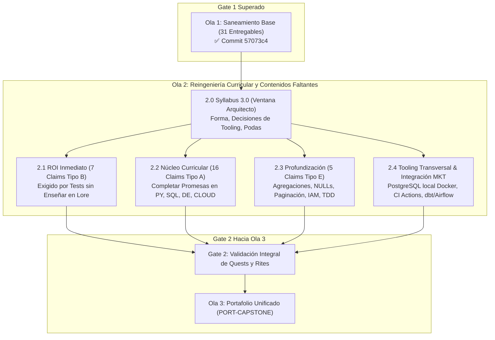

# Torre de Control y Roadmap de Remediación — Ola 2 (Syllabus 3.0 & Contenidos Faltantes)

> **Documento Rector:** [`meta/audits/2026-q3-contenido/analisis/dictamen-final-consolidado.md`](file:///Users/ander/Documents/DoJo/DoJo_Study/meta/audits/2026-q3-contenido/analisis/dictamen-final-consolidado.md)  
> **Ubicación Canónica de Gobernanza:** `meta/remediacion/`  
> **Estado General:** Fase de Arquitectura y Diseño Curricular (Syllabus 3.0)  
> **Fecha de Inicio:** 2026-10-13  
> **Prerrequisito Aprobado:** Gate 1 (Ola 1 cerrada al 100% en commit `57073c4`)

---

## 1. Misión y Alcance de la Ola 2

Habiendo saneado la totalidad de la base de código y eliminado los bloqueos mecánicos en la Ola 1 (31 entregables), la **Ola 2** tiene como objetivo **cerrar la brecha de contenido faltante y alinear el DoJo con las demandas del mercado laboral internacional 2026**.

---

## 2. Los 4 Pilares del Prerequisito: `Syllabus 3.0` (Ventana de Arquitecto)

Tal como lo dictamina la sección 4.2 del Dictamen Rector, antes de escribir una sola línea de contenido nuevo se resuelven las decisiones estructurales:

### 2.1 Decisión de Forma: Integración Natural vs Asignatura Aislada
* **Dictamen:** No fragmentar el aprendizaje en cursos hiper-específicos que aumenten la fatiga cognitiva del Operador.
* **Resolución:** **Integración en la Cadena Existente**:
  * **PostgreSQL real:** Se incorpora como motor de carga destino en `DE-PIPELINES` y motor relacional en `CLOUD-AWS` (RDS), desplazando el monocultivo de SQLite hacia pruebas unitarias en memoria.
  * **Warehouse Columnar & dbt:** Se integran en el tramo analítico avanzado de `DE-PIPELINES` (o puente directo al Capstone).
  * **AWS Glue + Athena:** Se incorporan en la sección analítica de `CLOUD-AWS`.
  * **Airflow básico:** Se enseña en `DE-PIPELINES` como estándar industrial junto a Prefect (DAGs, dependencias, reintentos).
  * **Docker pragmático:** Se adopta como tooling transversal para levantar Postgres y servicios locales sin fricción de instalación en el host.

### 2.2 Derogación de Contradicciones Históricas
* **Contenerización (Docker):** El `Protocol Yellow` trataba a Docker como complejidad opcional. El análisis de mercado laboral 2026 demuestra que Docker (`Dockerfile` y `docker-compose.yml`) es una expectativa pre-empleo básica. Se formaliza como herramienta transversal estándar del DoJo.
* **Spark:** El mercado le asigna un 33% sin declararlo obligatorio pre-empleo. Se define como lectura conceptual de arquitectura en `DE-PIPELINES` y se delega la práctica pesada a la Fase 2 (Post-empleo).

### 2.3 Formalización de Podas Curriculares (Las 3 Excepciones)
1. **Typer/Click (`PY-012`):** Queda formalmente podado a favor de `argparse` (ya enseñado y reconciliado en el Chronicle).
2. **Clean Architecture (`PY-015`):** Se redefine en el temario como "Diseño Modular por Capas y Separación de Responsabilidades", descartando dogmas teóricos que no aportan al rol de Data Automation.
3. **`load_dotenv` en Lambda:** Se erradica de las guías de Lambda; se enseña el estándar de producción: variables de entorno inyectadas por AWS Cloud y roles de ejecución IAM.

---

## 3. Matriz Maestra de Claims a Cerrar en Ola 2 (28 Claims + Integración MKT)

### 3.1 Bloque 2.1 — ROI Inmediato (Los 7 Tipo B: Exigidos sin Enseñar)
*Son conceptos que el Rite o los tests ya evalúan pero que el Lore nunca explicó. Tienen el ratio esfuerzo/beneficio más alto.*

| Claim ID | Subject | Componente | Concepto Faltante | Estrategia Pedagógica |
|---|---|---|---|---|
| **`PY-016`** | `02-py-poo` | Lore 03 / Rite | `collections.defaultdict` | Añadir sección en Lore 03 con Domain Shifting y ejercicio rápido |
| **`PY-017`** | `02-py-poo` | Lore 05 / Tests Rite | Fixture `tmp_path` de `pytest` | Explicar gestión de directorios efímeros para tests aislados |
| **`PY-018`** | `02-py-poo` | Lore 05 / Tests Rite | `pytest.approx` | Explicar precisión de punto flotante en aserciones numéricas |
| **`PY-019`** | `02-py-poo` | Lore 05 / Quest 03 | `@pytest.fixture` | Formalizar fixtures reutilizables en suite de pruebas |
| **`SQL-012`**| `03-sql-basico` | Lore 04 / Rite | Cardinalidad N:M y "Autor Principal" | Explicar modelado de relaciones N:M y resolución determinista |
| **`DE-006`** | `04-de-pipelines` | Lore 02 / Rite | `df.groupby` en Pandas | Añadir agregaciones y agrupamiento relacional en DataFrames |
| **`DE-010`** | `04-de-pipelines` | Lore 01 / DoD Rite | `mypy` en Data Pipelines | Guía rápida de tipado estricto en pipelines de datos |

---

### 3.2 Bloque 2.2 — Núcleo Curricular (Los 16 Tipo A: Completar lo Prometido)

| Claim ID | Subject | Promesa en Temario | Brecha Detectada | Entregable Ola 2 |
|---|---|---|---|---|
| **`PY-010`** | `02-py-poo` | Cap 02: Constructores con `super()` | Solo herencia básica sin delegación de inicializadores | Lore + Quest con jerarquías compuestas usando `super().__init__()` |
| **`PY-011`** | `02-py-poo` | Cap 06: Validación con Pydantic | Pydantic prometido pero no enseñado | Lore de modelos Pydantic + Quest de validación de esquemas |
| **`PY-013`** | `02-py-poo` | Cap 04: "Output Loaders" | Patrón Loader ausente | Quest modular con clase abstracta `BaseLoader` y subclases |
| **`PY-014`** | `02-py-poo` | Fase 1 Rite: `JSONExtractor` | Clase abstracta omitida | Quest/Andamiaje que modele la extracción desacoplada |
| **`SQL-005`** | `03-sql-basico` | Cap 08: `ROLLBACK` y ACID | Transacciones explicadas superficialmente sin práctica | Quest con transacciones explícitas (`BEGIN`, `COMMIT`, `ROLLBACK`) |
| **`DE-004`** | `04-de-pipelines` | Cap 04: Carga a PostgreSQL | Sustituido por SQLite en el 100% de ejercicios | Quest con PostgreSQL real (vía Docker) usando SQLAlchemy/psycopg |
| **`DE-005`** | `04-de-pipelines` | Cap 05: Orquestación Periódica | Scheduling con Prefect/Airflow ausente | Implementación de scheduler periódico y reintentos automáticos |
| **`DE-009`** | `04-de-pipelines` | Cap 05: Logs de ejecución | Reemplazado por `print()` | Integración de logger de orquestación (`get_run_logger` / logging estructurado) |
| **`AWS-004`** | `05-cloud-aws` | Cap 00: IAM Programático | Solo verificación de roles preexistentes | Quest con `boto3` para crear roles, policies y trust relationships |
| **`AWS-005`** | `05-cloud-aws` | Cap 01: Creación de Buckets | Solo upload a buckets creados en setup | Quest de aprovisionamiento `create_bucket` con validación DNS |
| **`AWS-006`** | `05-cloud-aws` | Cap 01: Serialización Parquet | Solo JSON plano | Quest de conversión DataFrame $\rightarrow$ Parquet con compresión Snappy en S3 |
| **`AWS-007`** | `05-cloud-aws` | Cap 02: RDS + Security Groups | Solo queries a base mockeada | Quest de configuración de red y conexión a base administrada |
| **`AWS-008`** | `05-cloud-aws` | Cap 03: Despliegue de Lambda | Solo handler unitario | Empaquetado zip y despliegue programático con `create_function` |
| **`AWS-009`** | `05-cloud-aws` | Cap 04: CloudWatch Alarms | Solo lectura de logs | Creación de alarmas de error sobre Metric Filters |
| **`MKT-002 (SQL)`** | `03-sql-basico` | Mercado: Modelado Dimensional | Falta SCD Tipo 2 | Ejercicio de Slowly Changing Dimensions Tipo 2 (historial de cambios) |
| **`MKT-002 (AWS)`** | `05-cloud-aws` | Mercado: Cero Hardcoding | Falta gestión de secretos | Uso de AWS Secrets Manager / KMS para credenciales |

---

### 3.3 Bloque 2.3 — Profundización de Habilidades (Los 5 Tipo E)

| Claim ID | Subject | Tema a Profundizar | Acción Pedagógica |
|---|---|---|---|
| **`SQL-006`** | `03-sql-basico` | Agregaciones condicionales | `SUM(CASE WHEN...)` y `COUNT(DISTINCT CASE...)` para pivoteo de métricas |
| **`SQL-013`** | `03-sql-basico` | Semántica tri-valor de `NULL` | Comportamiento de `NULL` en operadores lógicos, `IN`, `NOT IN` y `COALESCE` |
| **`DE-007`** | `04-de-pipelines` | Paginación resiliente de APIs | Consumo de APIs con cursor/offset pagination y manejo de rate limits |
| **`AWS-010`** | `05-cloud-aws` | Profundidad de políticas IAM | Evaluación de políticas IAM complejas (Deny explícito, condiciones, Resource ARNs) |
| **`PY-020`** | `02-py-poo` | Modelado de ciclo TDD | Modelado explícito del ciclo Red-Green-Refactor paso a paso |

---

### 3.4 Bloque 2.4 — Tooling Transversal e Integración de Mercado (CLAIM-MKT)

| Componente | Subject(s) | Implementación |
|---|---|---|
| **CI/CD con GitHub Actions** | `DE-PIPELINES`, `CLOUD-AWS` | Workflows `.github/workflows/ci.yml` ejecutando `pytest` y `mypy` |
| **Data Quality (`DQ`) Explícito**| `DE-PIPELINES` | Suite formal de validación de calidad antes de transformar y cargar |
| **Docker Compose Base** | Transversal | Archivo `docker-compose.yml` para levantar PostgreSQL efímero y reproducible |
| **AWS Athena / Glue (Concepto)**| `CLOUD-AWS` | Consultas federadas SQL sobre datos en formato Parquet en S3 |
| **dbt Básico (Transformación)** | `DE-PIPELINES` | Modelos SQL modulares con materialización en tabla/vista |

---

## 4. Cronograma de Ejecución Secuencial (Por Fases)

Para proteger la concentración y ergonomía del Operador:

1. **Fase 1: Formalización de `Syllabus 3.0` (Ventana de Arquitecto)**
   * Actualizar [`system/docs/05-syllabus-maestro.md`](file:///Users/ander/Documents/DoJo/DoJo_Study/system/docs/05-syllabus-maestro.md) con las decisiones tomadas.
   * Ratificar las podas curriculares en los cuatro chronicles.
2. **Fase 2: Bloque 2.1 — ROI Inmediato (Los 7 Tipo B)**
   * Lore snippets + micro-quests para `defaultdict`, fixtures de pytest, cardinalidad de JOIN y `df.groupby`.
3. **Fase 3: Bloque 2.2 y 2.3 por Materia (`PY-POO` $\rightarrow$ `SQL-BASICO` $\rightarrow$ `DE-PIPELINES` $\rightarrow$ `CLOUD-AWS`)**
   * Cada entrega respetará el principio de **Gate de Ejecución**: código ejecutable con `exit code 0`, plantillas con `pass` para el Operador (Carril A), y tests de validación.
4. **Fase 4: Tooling Transversal (Docker & CI Workflows)**
   * Configuración de contenedores y pipelines de verificación continua.
5. **Cierre de Gate 2:**
   * Verificación integral cruzada antes de dar paso al `PORT-CAPSTONE` (Ola 3).
