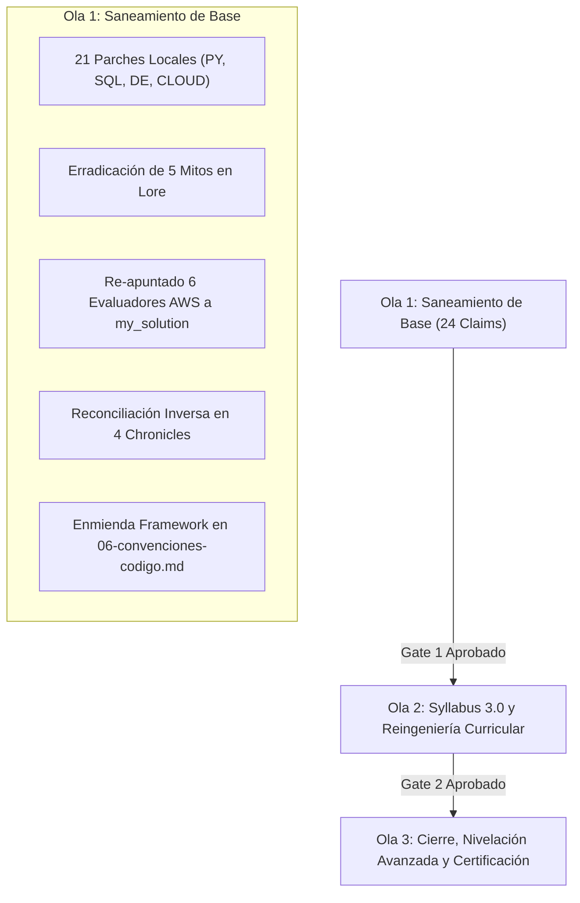

# Torre de Control y Roadmap de Remediación — DoJo Study

> **Documento Rector:** [dictamen-final-consolidado.md](file:///Users/ander/Documents/DoJo/DoJo_Study/meta/audits/2026-q3-contenido/analisis/dictamen-final-consolidado.md)  
> **Ubicación Canónica de Gobernanza:** `meta/remediacion/`  
> **Estado General:** Gate 1 Aprobado (100% Ola 1 Cerrada en commit `57073c4`) — Apertura de Ola 2  
> **Última Actualización:** 2026-10-13  
> **Hoja de Ruta Ola 2:** [`meta/remediacion/roadmap-ola-2.md`](roadmap-ola-2.md)

---

## 1. Visión Estratégica en Tres Olas

El proceso de remediación integral del DoJo se organiza en tres fases estrictamente secuenciales para garantizar calidad técnica sin comprometer el tiempo de estudio ni sobrecargar al Operador:

1. **Ola 1: Saneamiento de Base (Actual):**
   - Reparación de sintaxis rota de terceros en quests y ritos.
   - Re-apuntado de evaluadores para medir entregables reales.
   - Desmitificación conceptual en guías de estudio (`lore/`).
   - Reconciliación curricular inversa (declarar herramientas ya enseñadas).
   - Enmienda transversal de cierre seguro en `finally`.
   - **Regla de Cierre:** Cero generación de contenido nuevo en esta ola.
2. **Ola 2: Syllabus 3.0 y Reingeniería Curricular:**
   - Rediseño formal de los programas de estudio.
   - Poda formal de promesas curriculares infladas (Typer/Click, Clean Architecture).
   - Normalización de scaffolding y alineación metodológica.
3. **Ola 3: Cierre, Nivelación Avanzada y Certificación:**
   - Auditoría final de consistencia cruzada.
   - Consolidación del repositorio de producción.
   - Certificación de competencias del Operador.

---

## 2. Las 4 Reglas Rectoras de los Gates de Ejecución

Según lo dictaminado en el [Dictamen Final Consolidado (§5)](file:///Users/ander/Documents/DoJo/DoJo_Study/meta/audits/2026-q3-contenido/analisis/dictamen-final-consolidado.md), la ejecución de cada claim debe ceñirse a cuatro principios inviolables:

1. **Regla 1 — Verificación Binaria y Ejecutabilidad:**  
   Toda corrección debe contar con una **Sonda Inicial** (que demuestre el fallo en el código actual) y una **Sonda Final** (comando reproducible que finalice con `exit code 0` o el comportamiento binario esperado). No se aceptan cierres basados en asunciones teóricas.
2. **Regla 2 — Prohibición de Generación de Contenido en Ola 1:**  
   En la Ola 1 queda estrictamente prohibido redactar nuevas lecciones teóricas o crear ejercicios adicionales. El alcance se limita a parches locales precisos y adiciones mínimas a temarios para reflejar lo existente.
3. **Regla 3 — Separación Estricta de Carriles (A vs B):**  
   - **Carril A (Operador):** Tareas donde hubo un fallo de modelo mental (mitos técnicos, cardinalidad SQL, métricas de retención, Quality Gates defensivos, dataclasses con slots, exceptions vs assert). El Operador programa sus soluciones tras estudiar la regla conceptual explicada mediante **Domain Shifting** (sin soluciones masticadas).
   - **Carril B (Antigravity):** Plomería mecánica (reparación de sintaxis rota en scripts externos, re-apuntado de tests evaluadores, reconciliación curricular en `chronicle.md`, enmienda de convenciones).
4. **Regla 4 — Aislamiento de Gobernanza:**  
   Los cuadernos de remediación y bitácoras de mutación residen exclusivamente en `meta/remediacion/`. La carpeta `content/subjects/` permanece limpia, conteniendo únicamente el código y material canónico de estudio.
5. **Regla 5 — Especificación Didáctica Obligatoria (Contrato Pedagógico de Carril A):**  
   Toda tarea asignada al Operador en el Carril A debe contar obligatoriamente con:
   - **Diagnóstico Exacto:** Snippet del código actual problemático, números de línea y salida literal del error (MyPy, SQLite, Python).
   - **Referencia al Lore:** Enlace directo al capítulo de teoría donde se fundamenta el estándar.
   - **Ejemplo con Domain Shifting:** Código ilustrativo en un dominio ficticio que modele el patrón canónico correcto.
   - **Contrato de Modificación:** Qué propiedad debe tener el archivo editado para superar la sonda final. Queda terminantemente prohibido dejar tareas con explicaciones abstractas sin código de referencia.

---

## 3. Matriz Maestra de Seguimiento — Ola 1 (24 Claims de Auditoría + 7 Tareas de Infraestructura = 31 Entregables)

| Claim ID | Subject | Carril | Archivo / Componente | Descripción Resumida | Estado |
|---|---|---|---|---|---|
| **Convención** | Framework | B | `system/docs/06-convenciones-codigo.md` | Enmienda: cierre determinista `if conn is not None: conn.close()` | ✅ Completado |
| **Gate SQL Runner** | Framework | B | `system/tools/sql_runner.py` | Runner agnóstico de SQL en memoria efímera (§5.3 del rector) | ✅ Completado |
| **PY-001** | `02-py-poo` | B | `quests/04-orchestration/pipeline.py` | Import faltante de `Reader` en pipeline desacoplado | ✅ Completado |
| **PY-002** | `02-py-poo` | B | `quests/03-engines/weather_engine.py` | Variable de comprensión generadora corregida | ✅ Completado |
| **PY-003** | `02-py-poo` | B | `quests/07-cli/cli2.py` | Import faltante de `GameLoader` en script CLI | ✅ Completado |
| **PY-004** | `02-py-poo` | B | `rite/src/cli.py` | Ejecución como módulo vs script con paths relativos | ✅ Completado |
| **PY-005** | `02-py-poo` | A | `rite/src/pipeline.py` | Propagación de excepción en fallo de ingesta | ✅ Completado |
| **PY-006** | `02-py-poo` | A/B | `quests/02-entities/inventory.py` `lore/02-domain-entities...md` | Dataclass `slots=True` en inventory (A) + desmitificación en Lore 02 (B) | ✅ Completado |
| **PY-007** | `02-py-poo` | B | `lore/01-abstract-classes...md` | Mito 1: Corrección de prosa en Lore 01 (validación runtime al instanciar) | ✅ Completado |
| **PY-008** | `02-py-poo` | A | `rite/src/transactions.py` | Tipado estricto MyPy: retorno `-> float` en métodos sobrescritos | ✅ Completado |
| **PY-009** | `02-py-poo` | A | `quests/00-classes/shopping_cart.py` | Semántica `__init__`: retorno implícito `None`, no `-> dict` | ✅ Completado |
| **PY-021/022**| `02-py-poo` | B | `chronicle.md` | Reconciliación Inversa: declarar `@dataclass` y `argparse` | ✅ Completado |
| **SQL-001** | `03-sql-basico` | B | `quests/03-functions/case-when.sql` | Sintaxis completa de `CASE WHEN` | ✅ Completado |
| **SQL-002** | `03-sql-basico` | B | `quests/06-subqueries/01.sql` | Delimitador `;` entre consultas independientes | ✅ Completado |
| **SQL-003** | `03-sql-basico` | B | `rite/rite.sql` | Eliminación de `DROP TABLE loans` residual para idempotencia | ✅ Completado |
| **SQL-004** | `03-sql-basico` | B | `lore/04-joins-and-relationships.md` | Mito 2: Corrección de prosa en Lore 04 (soporte nativo RIGHT/FULL JOIN) | ✅ Completado |
| **SQL-008** | `03-sql-basico` | A | `rite/rite.sql` (Reporte 1) | Resolución de cardinalidad N:M con autor principal | ✅ Completado |
| **SQL-009** | `03-sql-basico` | A | `rite/rite.sql` (Reporte 2) | Métrica de retención con `COALESCE` para libros devueltos | ✅ Completado |
| **SQL-010** | `03-sql-basico` | A | `quests/07-windows/07_01.sql` | Ordenación cronológica `ORDER BY sale_date` en función `LAG` | ✅ Completado |
| **SQL-011** | `03-sql-basico` | A | `quests/02-filtering/01-crud...md` | Collation SQLite y coincidencia de tildes | ✅ Completado |
| **SQL-007** | `03-sql-basico` | B | `chronicle.md` | Reconciliación Inversa: `foreign_keys`, `CTAS`, `DENSE_RANK` | ✅ Completado |
| **DE-008** | `04-de-pipelines`| B | `chronicle.md` | Reconciliación Inversa: declarar mocking HTTP con `responses` | ✅ Completado |
| **DE-003** | `04-de-pipelines`| B | `lore/03-data-quality.md` | Mito 3: Flag `-O` elimina `assert` en modo optimizado | ✅ Completado |
| **DE-001** | `04-de-pipelines`| A | `rite/src/pipeline.py` / `config.py` | Fallback de ingesta a fixture/mock local en runtime autónomo | ✅ Completado |
| **DE-002** | `04-de-pipelines`| A | `rite/src/quality.py` | Quality Gate: excepciones de dominio en vez de `assert` | ✅ Completado |
| **Evaluadores**| `05-cloud-aws` | B | `quests/*/reference/reference_test.py` | Re-apuntar 8 imports y 7 patches de `solution` a `my_solution` | ✅ Completado |
| **AWS-012** | `05-cloud-aws` | B | `chronicle.md` | Reconciliación Inversa: declarar `unittest.mock` y ACID | ✅ Completado |
| **AWS-003** | `05-cloud-aws` | B | `lore/03-aws-lambda.md` | Mito 4/5: Eventos asíncronos S3 descartan return; propagar `raise` | ✅ Completado |
| **AWS-001** | `05-cloud-aws` | A | `quests/02-aws-rds/my_solution.py` | Cierre seguro `if conn is not None: conn.close()` | ✅ Completado |
| **AWS-002** | `05-cloud-aws` | A | `quests/01-aws-s3/my_solution.py` | Nomenclatura DNS de buckets S3 y validación client-side | ✅ Completado |
| **AWS-011** | `05-cloud-aws` | A | `quests/04-aws-cloudwatch/my_solution.py` | Coincidencia literal en Metric Filters de CloudWatch | ✅ Completado |

---

## 4. Decisiones de Arquitectura y Trazabilidad de Backlog

Para resolver tensiones entre las distintas secciones del Dictamen Rector ([dictamen-final-consolidado.md](file:///Users/ander/Documents/DoJo/DoJo_Study/meta/audits/2026-q3-contenido/analisis/dictamen-final-consolidado.md)):

1. **Ubicación de Informativos F (Reconciliación Inversa):**  
   Aunque la tabla de §6 los agrupa aritméticamente hacia la Ola 2, el texto de §1.3 y §4 1.3 dictamina explícitamente formalizarlos en la Ola 1 (*"edición de chronicle, media hora"*). Se ejecutan en el Carril B de la Ola 1 para erradicar las discrepancias curriculares desde el día uno.
2. **Criterio de Orden Secuencial:**  
   Se organiza por subject (`02-py-poo` $\rightarrow$ `03-sql-basico` $\rightarrow$ `04-de-pipelines` $\rightarrow$ `05-cloud-aws`) para proteger la ergonomía cognitiva del Operador, evitando la fatiga de alternar entre tecnologías dispares en una misma jornada. No obstante, **dentro de cada subject se respeta estrictamente la precedencia del §4 1.1**: primero la higiene que impide ejecutar (Carril B), luego los hábitos en el código del Operador (Carril A), y finalmente la prosa de Lore.
3. **Backlog del Protocolo de Auditoría (20 Observaciones):**  
   Las 20 observaciones metodológicas derivadas de la ejecución de la auditoría quedan registradas en el backlog del sistema asignadas a la ventana de Arquitecto post-Ola 1 (§6 y §7), sin distraer el tiempo de estudio activo del Operador.

---

## 5. Bitácoras Tácticas por Subject

Cada materia cuenta con su documento de trabajo detallado:
- [`02-py-poo.md`](file:///Users/ander/Documents/DoJo/DoJo_Study/meta/remediacion/02-py-poo.md)
- [`03-sql-basico.md`](file:///Users/ander/Documents/DoJo/DoJo_Study/meta/remediacion/03-sql-basico.md)
- [`04-de-pipelines.md`](file:///Users/ander/Documents/DoJo/DoJo_Study/meta/remediacion/04-de-pipelines.md)
- [`05-cloud-aws.md`](file:///Users/ander/Documents/DoJo/DoJo_Study/meta/remediacion/05-cloud-aws.md)

---

## 6. Criterios de Aprobación de Gate 1 (Superado ✅)

Para declarar concluida la Ola 1 y abrir la Ola 2 (Syllabus 3.0):
1. **100% de claims en estado verde:** Todos los comandos de verificación binaria reportados con `exit code 0` (31/31 entregables).
2. **Registro de bitácoras completas:** Cuadernos `02-py-poo.md`, `03-sql-basico.md`, `04-de-pipelines.md` y `05-cloud-aws.md` con trazabilidad completa de sondas iniciales y finales.
3. **Cero regresión:** Todas las suites de tests unitarios existentes en los ritos ejecutadas con éxito sin fallos colaterales.
4. **Commit de Cierre:** Registrado en `57073c4117bf5ebdf7e736a57e6c03637b8dbe67` en la rama `chronicles`.

> **Transición:** La ejecución continúa formalmente en [`roadmap-ola-2.md`](file:///Users/ander/Documents/DoJo/DoJo_Study/meta/remediacion/roadmap-ola-2.md).

