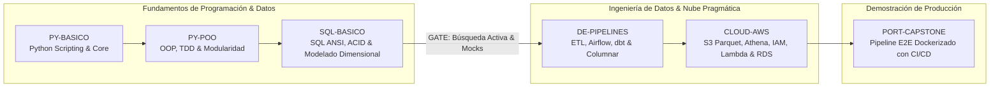

# 05 - Syllabus Maestro 3.0 (Data & Automation Engineer — Pre-Empleo)

> **Estado:** Activo (Ruta Crítica Pre-Empleo — Versión 3.0)  
> **Estatus Epistémico:** Contrato curricular objetivo (Syllabus 3.0). Los contenidos nuevos se despliegan en la Ola 3 y su verificación formal se valida contra el material real en Gate 2 (Ola 2 cerrada en `679a9d3`).  
> **Documento Rector de Auditoría:** [`meta/audits/2026-q3-contenido/analisis/dictamen-final-consolidado.md`](file:///Users/ander/Documents/DoJo/DoJo_Study/meta/audits/2026-q3-contenido/analisis/dictamen-final-consolidado.md)  
> **Hoja de Ruta de Ejecución:** [`meta/remediacion/ola-3/roadmap-ola-3.md`](file:///Users/ander/Documents/DoJo/DoJo_Study/meta/remediacion/ola-3/roadmap-ola-3.md) (Ola 3 v2; la Ola 2 cerró en `679a9d3`)  
> **Objetivo:** Primer empleo en datos **en Colombia** (Analytics Engineer / Data Analyst junior) en 4–7 meses; el salto a remoto internacional como **Data Automation Engineer / Python Automation Developer / ETL Integration Developer** queda como destino a 12–24 meses.  
> **Fase 2 (Post-Empleo):** Especialización corporativa y escalabilidad avanzada desacopladas en [`06-syllabus-post-empleo-fase2.md`](06-syllabus-post-empleo-fase2.md).

---

## 1. Visión y Enfoque de Empleabilidad 3.0

El **Syllabus 3.0** representa la reingeniería curricular definitiva del DoJo Study. Está construido a partir de la evidencia empírica del mercado laboral internacional 2026 (corpus consolidado de más de 8.000 vacantes técnicas) y del dictamen de la auditoría técnica integral Q3-2026.

### Principios Rectores de la Versión 3.0:
1. **La Cadena Funciona de Extremo a Extremo:** El mercado no busca acumuladores de cursos ni diplomas teóricos; busca ingenieros capaces de construir cadenas de datos robustas, tipadas, testeadas, orquestadas y monitoreadas.
2. **Superación del Monocultivo de SQLite en Pipelines:** Si bien `SQL-BASICO` enseña los fundamentos universales de SQL ANSI y modelado sobre un motor relacional embebido, los pipelines de datos productivos y almacenamiento en la nube operan sobre **PostgreSQL real** (domiciliado en `DE-PIPELINES`, `CLOUD-AWS` y `PORT-CAPSTONE`). SQLite queda confinado al aprendizaje sintáctico inicial y pruebas unitarias efímeras en memoria (`:memory:`).
3. **Integración Natural sobre Fragmentación:** Las herramientas demandadas por la industria (**dbt, Airflow básico, Cloud Warehouse columnar, AWS Glue/Athena, Docker, Secrets Manager, Parquet**) no se dispersan en micro-cursos aislados: se integran directamente en las Chronicles existentes (`DE-PIPELINES` y `CLOUD-AWS`) y convergen en el proyecto de portafolio (`PORT-CAPSTONE`).
4. **Cero Tolerancia a Promesas sin Código:** Todo concepto declarado en este temario cuenta con respaldo pedagógico en `lore/`, laboratorios con pruebas automatizadas en `quests/`, y evaluación rigurosa en `rite/` bajo la regla de **Bucle de Ejecución Cerrado (`exit code 0`)**.



---

## 2. Mapa de Chronicles en `subjects/`

| Chronicle | Área | Competencias Clave y Entregables de Producción |
|---|---|---|
| **`PY-BASICO`** | Python | Sintaxis profesional, tipos de datos, control de flujo, scripting robusto y manejo de errores. |
| **`PY-POO`** | Python | Programación Orientada a Objetos, TDD (`pytest`), modularización por capas, fixtures (`tmp_path`), validación de esquemas con **Pydantic**, constructores con `super()`, patrón Output Loaders y tipado estricto (`mypy`). |
| **`SQL-BASICO`** | SQL | DDL, constraints relacionales, CRUD, relaciones complejas y cardinalidad N:M, CTEs encadenadas, Window Functions (`LAG`, `LEAD`, sumas móviles), transacciones ACID (`BEGIN`, `COMMIT`, `ROLLBACK`), agregaciones condicionales, semántica tri-valor de `NULL`, y **Modelado Dimensional (Star Schema y SCD Tipo 2)**. |
| **`DE-PIPELINES`** | Data Engineering | Ingesta resiliente con paginación de APIs REST y rate limiting, manipulación con Pandas (`df.groupby`), Data Quality defensivo con excepciones de dominio, carga a **PostgreSQL real** (Docker), orquestación con DAGs (**Prefect** y **Apache Airflow básico**), transformación declarativa con **dbt**, y carga a **Cloud Warehouse Columnar** (BigQuery / Snowflake sandbox o DuckDB local). |
| **`CLOUD-AWS`** | Cloud Computing | Aprovisionamiento programático con `boto3` (IAM roles/policies de mínimo privilegio, buckets S3 `create_bucket`), almacenamiento columnar **Parquet** con compresión en S3, consultas analíticas serverless con **AWS Glue + Athena**, RDS PostgreSQL + Security Groups, serverless Lambda (empaquetado, variables de entorno de AWS e IAM roles), CloudWatch logs y alertas métricas, y gestión segura de credenciales con **AWS Secrets Manager / KMS** (cero hardcoding). |
| **`PORT-CAPSTONE`** | Portafolio | Pipeline de datos productivo end-to-end completamente contenerizado con **Docker**, orquestado, con CI/CD en **GitHub Actions**, Data Quality gates, almacenamiento S3/Parquet, dbt, PostgreSQL/Warehouse, monitoreo y documentación técnica en inglés. |

---

## 3. Bloques Temáticos de la Ruta Pre-Empleo

### 🐍 PY – Python Core, OOP & Testing Automation
*Chronicles asociadas: `PY-BASICO` y `PY-POO`.*
- Sintaxis profesional, tipos de datos inmutables y manejo de excepciones robusto.
- Programación Orientada a Objetos: clases, composición sobre herencia, polimorfismo, properties, dunder methods y jerarquías con inicialización explícita mediante `super().__init__()`.
- **Estructuras de Colecciones:** Uso eficiente de `collections.defaultdict`, `Counter` y generadores.
- **Validación de Esquemas:** Modelos de datos y contratos estrictos mediante **Pydantic**.
- **Arquitectura Modular por Capas:** Patrón Extractor / Loader desacoplado (`BaseLoader`, `JSONExtractor`) separando lógica de dominio de I/O.
- **Test-Driven Development (TDD):** Ciclo Red-Green-Refactor modelado paso a paso con `pytest`.
- **Testing Avanzado:** Fixtures reutilizables (`@pytest.fixture`), manejo de directorios temporales aislados (`tmp_path`), aserciones numéricas de precisión (`pytest.approx`) y mocking de dependencias externas.
- **Tipado Estricto & Calidad:** Tipado estático con `mypy`, docstrings canónicos y logging estructurado (`logging`).
- **Interfaces CLI:** Creación de herramientas de línea de comandos mediante `argparse` estándar.

---

### 🗄️ SQL – Bases de Datos Relacionales, ACID & Modelado Dimensional
*Chronicle asociada: `SQL-BASICO`.*
- Fundamentos relacionales, DDL (`CREATE`, `ALTER`, `DROP`), tipos de datos explícitos y restricciones de integridad (`PK`, `FK`, `UNIQUE`, `CHECK`, `CASCADE`).
- Consultas intermedias y avanzadas: `WHERE`, `ORDER BY`, funciones escalares (`CASE WHEN`, `COALESCE`, `NULLIF`, `CAST`), agregaciones condicionales (`SUM/COUNT` con `CASE`).
- **Semántica de Nulos:** Manejo riguroso de la lógica tri-valor de SQL (`TRUE`, `FALSE`, `UNKNOWN`), comportamiento en operadores de conjunto e impacto en funciones de agregación.
- **Relaciones Complejas & Cardinalidad:** `INNER`, `LEFT`, `CROSS`, Self-Joins, resolución determinista de relaciones N:M ("Autor Principal" / deduplicación controlada).
- Expresiones de tabla común (**CTEs**) jerárquicas y subqueries correlacionadas.
- **Window Functions:** `ROW_NUMBER()`, `RANK()`, `DENSE_RANK()`, `LAG()`, `LEAD()`, ventanas móviles de tiempo y ordenación explícita.
- **Transacciones ACID en Producción:** Control de concurrencia y atomicidad mediante bloques transaccionales explícitos (`BEGIN`, `COMMIT`, `ROLLBACK`).
- **Modelado Dimensional (OLAP):**
  - Diferencias arquitectónicas entre OLTP (normalización) y OLAP (desnormalización analítica).
  - Diseño de Esquema en Estrella (*Star Schema*): tablas de hechos (*Fact Tables*) con métricas aditivas/semiaditivas y tablas de dimensiones (*Dimension Tables*) con llaves subrogadas (*Surrogate Keys*).
  - **Slowly Changing Dimensions (SCD Tipo 2):** Gestión del historial de cambios mediante llaves de versión, fechas de vigencia (`start_date`, `end_date`) e indicador de registro activo (`is_current`).

---

### 🛡️ DQ – Data Quality, Contratos & Observabilidad *(Práctica Transversal)*
> **Regla de Arquitectura:** `DQ` no constituye una Chronicle teórica aislada. Se enseña e implementa de manera defensiva en `DE-PIPELINES` y se valida en `PORT-CAPSTONE`.

- Validación de esquemas y tipado de entrada previo al procesamiento.
- Reglas de integridad cuantitativa: umbrales de pérdida de registros (*Loss Rate Checks*), detección de duplicados y reconciliación de balances pre/post transformación.
- **Calidad Defensiva sin Assertions:** Erradicación del antipatrón `assert` en código productivo; uso sistemático de excepciones de dominio específicas (`DataQualityError`, `RateError`) que garantizan detención bajo flags de optimización (`-O`).
- Verificaciones de integridad referencial y de nulos en columnas críticas.
- Estrategias de reintentos con *exponential backoff* y *jitter* ante fallos transitorios de red.
- Logging estructurado y observabilidad de calidad para trazabilidad y auditoría.

---

### ⚙️ DE – Data Pipelines, Ingesta Resiliente, dbt & Orquestación
*Chronicle asociada: `DE-PIPELINES`.*
- Arquitecturas y patrones de datos: ETL vs ELT, diseño por zonas (*Raw / Bronze*, *Cleaned / Silver*, *Curated / Gold*).
- **Consumo Resiliente de APIs REST:** Autenticación por tokens/headers, paginación real (offset/cursor pagination), control de rate limits y mocking defensivo para tests unitarios (`responses`).
- **Transformación de Datos con Pandas:** Limpieza, tipado defensivo, operaciones de agrupamiento y agregación multivariable (`df.groupby`).
- **Carga a PostgreSQL Real:** Conexión y persistencia mediante SQLAlchemy y psycopg hacia bases de datos PostgreSQL contenerizadas.
- **Transformación Declarativa con dbt:** Introducción práctica a **dbt Core** (modelos SQL modulares, fuentes `sources.yml`, materializaciones en tablas y vistas, y pruebas de integridad de esquema `unique`, `not_null`).
- **Almacenamiento Columnar Analítico:** Conceptos y carga hacia **Cloud Warehouse Columnar** (Snowflake / BigQuery sandbox o proxy local con DuckDB) demostrando ventajas de almacenamiento por columnas y compresión.
- **Orquestación con DAGs:**
  - Definición de pipelines mediante grafos dirigidos acíclicos (**Prefect** y **Apache Airflow básico**).
  - Tareas dependientes (`>>`), operadores estándar (`PythonOperator`), sensores y calendarización con expresiones cron.
  - Gestión de logs de ejecución estructurados (`get_run_logger`) y políticas automáticas de reintentos.
- **Perspectiva de Arquitectura:** Lectura conceptual de procesamiento distribuido con Apache Spark (distinción batch/streaming y trade-offs frente a motores vectorizados).

---

### ☁️ CLOUD – AWS Pragmático para Data Engineers
*Chronicle asociada: `CLOUD-AWS`.*
- Fundamentos de infraestructura cloud, seguridad y mínimos privilegios.
- **AWS IAM Programático:** Creación de usuarios de servicio, roles, políticas de mínimo privilegio y trust relationships mediante `boto3`.
- **Seguridad & Cero Hardcoding:** Gestión de credenciales, tokens y llaves de conexión mediante **AWS Secrets Manager / KMS** y variables de entorno seguras.
- **Amazon S3:** Creación programática de buckets (`create_bucket`) con validación de nomenclatura DNS, particionamiento jerárquico por fecha (`year/month/day`), almacenamiento raw JSON y **serialización columnar en formato Parquet** con compresión Snappy/ZSTD.
- **AWS Glue & Athena:** Registro de catálogos de metadatos (Data Catalog) y consultas SQL federadas directamente sobre datasets Parquet en S3 sin aprovisionar servidores.
- **Amazon RDS:** Aprovisionamiento, configuración de grupos de seguridad (Security Groups) y conexión segura a instancias administradas de PostgreSQL.
- **AWS Lambda Serverless:** Empaquetado de código, despliegue programático (`create_function`), inyección de variables de entorno de AWS, roles de ejecución IAM y manejo de eventos asíncronos S3 sin acoplamiento a retornos síncronos.
- **Amazon CloudWatch:** Creación de Log Groups, retención de logs, Metric Filters sobre patrones de error y configuración de alarmas automatizadas.

---

### 🐳 DOCKER – Contenerización Pragmática *(Práctica Transversal)*
> **Regla de Arquitectura:** Derogando la cláusula de opcional de versiones previas, Docker se formaliza como estándar obligatorio desde `DE-PIPELINES` para garantizar reproducibilidad absoluta.

- Creación de imágenes reproducibles mediante `Dockerfile` multi-stage optimizados.
- Orquestación local multi-contenedor con `docker-compose.yml`:
  - Instancia local de PostgreSQL con volumen persistente y scripts de inicialización `init.sql`.
  - Contenedores de prueba y orquestación efímeros.
- Gestión de redes internas, variables de entorno y aislamiento de dependencias.

---

### 🔄 GIT-CI – Control de Versiones & Integración Continua Automática *(Práctica Transversal)*
> **Regla de Arquitectura:** `GIT-CI` es obligatorio desde `DE-PIPELINES` y se automatiza en `PORT-CAPSTONE`.

- Convenciones de commits semánticos (*Conventional Commits*: `feat`, `fix`, `refactor`, `test`, `chore`, `docs`).
- Estrategia de branching profesional (*feature branches* y Pull Requests con code review).
- **GitHub Actions:** Configuración de workflows `.github/workflows/ci.yml` que disparan automáticamente en cada `push` o `pull_request`:
  - Linter y formateo de código.
  - Chequeo de tipos estáticos con `mypy`.
  - Ejecución de la suite completa de `pytest` con reporte de cobertura.

---

### 🗣️ ENG-INT – Inglés Técnico Aplicado & Mock Interviews *(Práctica Transversal)*
- **Nivel Objetivo:** B2+ funcional enfocado en comunicación técnica fluida para procesos de selección internacionales.
- **Producción Técnica:** 100% de artefactos de producción (código, variables, comentarios, docstrings, commits, PRs y READMEs) redactados en **Inglés profesional**.
- **Simulacros de Entrevistas Técnicas:** Prácticas socráticas regulares para explicar decisiones de diseño, trade-offs arquitectónicos y resolución de live coding en vivo.

---

## 4. Podas Curriculares y Reconciliaciones Formales

En estricto apego al Dictamen Rector (§4 2.4), se formalizan tres podas estratégicas para proteger el tiempo de estudio activo del Operador de promesas infladas o antipatrones:

1. **Poda de Typer/Click (`PY-012`):**  
   *Justificación:* El material ya enseña y domina `argparse` estándar de la librería estándar de Python. Se formaliza `argparse` en el temario y se suelta la promesa de frameworks CLI externos, evitando dependencias innecesarias en pipelines headless.
2. **Poda de Clean Architecture Dogmática (`PY-015`):**  
   *Justificación:* La "Clean Architecture" dogmática introduce niveles de indirección innecesarios para pipelines de ingeniería de datos. Se sustituye formalmente por **"Diseño Modular por Capas y Separación de Responsabilidades"** (Extractors, Transformers, Loaders, Data Models).
3. **Poda de `load_dotenv` en Contexto Serverless (Lambda):**  
   *Justificación y Criterio:* Cargar archivos `.env` locales dentro de una función AWS Lambda en ejecución es un antipatrón en la nube. Se erradica de las guías serverless y se enseña el estándar de producción: variables de entorno nativas inyectadas por AWS Cloud y Secrets Manager. Se tolera el uso de `.env` exclusivamente en scripts locales de desarrollo y bootstrapping inicial para conectarse a RDS desde la máquina del desarrollador.

---

## 5. Delimitación de Frontera con Fase 2 (Post-Empleo RFC v5.2.0)

Para blindar la velocidad de inserción laboral y evitar que tecnologías corporativas avanzadas desvíen la atención del núcleo pre-empleo, la frontera queda establecida según el RFC v5.2.0:

| Dominio | Incluido en Ruta Pre-Empleo (Syllabus 3.0) | Retenido para Fase 2 (Post-Empleo) |
|---|---|---|
| **Bases de Datos & Transformación** | PostgreSQL real, SQLite in-memory, dbt básico, Modelado Star Schema, SCD Tipo 2, Cloud Warehouse básico (Snowflake/BigQuery). | Databricks Lakehouse empresarial, optimizaciones avanzadas de clústeres, Delta Lake / Iceberg a gran escala. |
| **Orquestación & Big Data** | Apache Airflow básico (DAGs, PythonOperator, retries), Prefect local. Lectura conceptual de Apache Spark. | Clústeres distribuidos de Apache Spark (PySpark) y Apache Kafka para streaming en tiempo real. |
| **Infraestructura & Contenedores** | Docker pragmático (`Dockerfile`, `docker-compose.yml`), AWS IAM básico, S3, RDS, Lambda, CloudWatch, Secrets Manager. | Kubernetes (K8s), Helm charts, Infraestructura como Código avanzada con Terraform multi-ambiente. |
| **Testing & CI/CD** | TDD con `pytest`, fixtures modulares, mocking HTTP, `mypy`, GitHub Actions básicos. | Testing formal E2E empresarial, pruebas de carga y estrés masivo, auditoría SOC2/GDPR corporativa. |
| **Analítica & Especialización** | SQL analítico avanzado, Glue Data Catalog, consultas Athena serverless, **BI básico (Power BI/Looker Studio, dashboard y métricas de negocio)**. | BI empresarial (semantic models, RLS, Fabric/Power BI Premium), modelos LLM/RAG/GenAI (~9% de ofertas iniciales). |

---

## 6. Especificación del Portafolio: `PORT-CAPSTONE` + Caso BI/SQL

El portafolio se concentra en **2 artefactos complementarios** que demuestran el perfil de **Analytics Engineer / Data Analyst junior**:

1. **Artefacto 1 — `PORT-CAPSTONE`:** pipeline end-to-end robusto y desplegable (la cadena moderna completa de Data & Automation Engineering), con un **hecho a grano de contrato** (`fact_contrato`, SECOP II) conectado a `dim_entidad_scd2` por la versión vigente a la fecha y a `dim_fecha` con la TRM COP/USD.
2. **Artefacto 2 — Caso BI/SQL de negocio:** pregunta de negocio acotada, SQL analítico reproducible y dashboard con hallazgos y recomendación.

El Artefacto 1 demuestra la cadena completa:

```
[ Fuente Externa: API REST Pública con Paginación ]
                 │
                 ▼
[ 1. Ingestor en Python (Requests / Pydantic / Secrets Manager) ]
                 │
                 ▼
[ 2. Data Quality Layer (Loss Rate, Schema Validation, Excepciones de Dominio) ]
                 │
                 ├──────────────────────────────┐
                 ▼                              ▼
    [ 3. Raw Storage en AWS S3 ]    [ 4. Transformación Declarativa (Pandas / dbt) ]
       (Formato Parquet Snappy)                 │
                 │                              ▼
                 │              [ 5. Carga a RDS/PostgreSQL & Columnar ]
                 │              (Modelado Dimensional: Star Schema + SCD Tipo 2)
                 │                              │
                 ▼                              ▼
    [ 6. AWS Glue + Athena ]       [ 7. Post-Load Quality Checks ]
    (Consultas Serverless)         (Reconciliación de Row Counts y Balances)
                 │                              │
                 └──────────────┬───────────────┘
                                │
                                ▼
                    [ 8. Orquestación Periódica ]
                    (DAG en Airflow/Prefect con reintentos y logs)
                                │
                                ▼
                    [ 9. Monitoreo & Logs (CloudWatch) ]
                    (Alertas Métricas sobre Fallos de Ejecución)
```

### Entregables de los 2 artefactos:
1. **Artefacto 1 — Pipeline E2E:** estructura modular (`src/`, `tests/`, `models_dbt/`, `docker-compose.yml`, `.github/workflows/`) con ingestión paginada, DQ, PostgreSQL, dbt, **`fact_contrato` + `dim_entidad_scd2` + `dim_fecha` con TRM**, orquestación y cero hechos huérfanos.
2. **Artefacto 1 — Dashboard y métricas:** 5 métricas de negocio, 3 insights y 1 recomendación, con dashboard reproducible (Power BI/Looker Studio).
3. **Artefacto 2 — Caso BI/SQL:** pregunta de negocio acotada, SQL analítico (CTEs, window functions, cohortes) y dashboard con conclusión accionable.
4. **Repositorio publicable:** exportación por allowlist desde el monorepo a un repo público único (README raíz + una carpeta por artefacto), con denylist de `.env`, `data/`, credenciales y acceptance tests. La publicación pública es deseable pero **no bloqueante** para el primer empleo local; el checklist vive en `PUBLICAR.md`.
5. **Entorno Dockerizado Reproducible:** `docker compose up` levanta PostgreSQL y el pipeline completo.
6. **CI/CD Activo:** GitHub Actions con linter, `mypy`, `pytest` y tests de aceptación.
7. **README bilingüe:** resumen ejecutivo en español + documentación técnica en inglés; arquitectura, decisiones (ETL vs ELT, Parquet vs JSON, SCD2), métricas de impacto y límites.
8. **Video Demo / Loom (3–5 min):** explicación ejecutiva en español e inglés, incluyendo recuperación ante fallos.

---

## 7. El Disparador del Gate de Búsqueda Activa

> [!IMPORTANT]
> **GATE DE BÚSQUEDA PARALELA — MERCADO COLOMBIANO:**  
> La postulación **NO espera** a que el Corte 2 (cloud) esté terminado.
> 
> * **Hito de Activación:** cierre del **Gate E1** (2 artefactos + CV + LinkedIn + tracker), al final de la Semana 8. La Semana 8 se usa además para MQ-03/MQ-04 (pre-cloud); **las postulaciones empiezan en la Semana 9**.
> * **Justificación Técnica:** con `PY-POO`, `SQL-BASICO`, el Artefacto 1 (pipeline + dbt + `fact_contrato` + SCD2 + dashboard) y el Artefacto 2 (caso BI/SQL), el Operador cubre las competencias que evalúan las pruebas de *Live Coding* y *Technical Screening* del mercado local.
> * **Acción a partir del Hito:** bloque semanal inamovible para **10–15 postulaciones dirigidas** en canales colombianos y remotos LatAm (LinkedIn, Computrabajo, Elempleo, Magneto, GetOnBrd, Torre), **3–5 contactos de referido/semana**, **5 h de inglés técnico** y **1 simulacro de entrevista/semana**, mientras se completa el Corte 2 en paralelo.
> * **Stop Rule:** ninguna tarea técnica del Corte 2 puede recortar las 10 postulaciones semanales.
